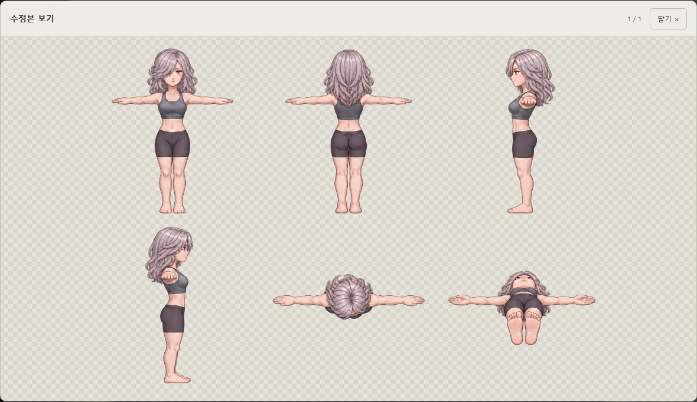

## 작업 결과

## 변경 내용

### 적용 내용

트레이와 알림을 WebView2 창에 연결하고 Windows 프로토콜을 등록했습니다. CLI는 트레이 서버 또는 작업 종료 시 정리하는 임시 서버를 사용합니다. 프로젝트 a7ae4390 푸시.

## 검증

숨긴 WebView2 창에서 실제 대시보드를 읽었고, 종료 기능이 창·WebView2 프로세스·관리 서버를 함께 정리하는 것을 확인했습니다. 등록된 Windows 트레이 서버에 연결하고 헤드리스 CLI로 실제 로그를 펼쳐 모달 표시와 PNG 저장을 확인했습니다. 대시보드 빌드 4.78초.

## 남은 사항

공개 배포는 미확인입니다.

## 작업 시간

- 제안 시간: 10분
- 실제로 완료된 시간: 약 10분, 2026-11-23 18:14 KST 프로젝트 푸시
- XERJ: 미사용 — 코드 검색 근거가 제공되지 않았습니다.
