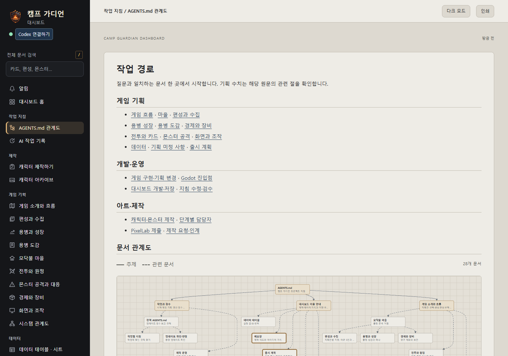

## 작업 결과

관계도 진입 문서를 13,149바이트에서 1,017바이트로 줄이고 다섯 작업 요약을 개별 파일로 분리했습니다.

## 변경 내용

### 적용 내용

게임 기획 12개 바로가기와 개발·운영·아트·제작 경로. 상세 노드와 기존 검토 기록은 대시보드 용도로 보존했습니다.

## 검증

대시보드 빌드 및 Chrome에서 전투와 카드 → 전투와 원정 문서 열기 확인.

## 남은 사항

공개 Pages 배포 상태는 미확인입니다.

## 작업 시간

- 제안 시간: 작업·빌드 확인 10분 이내
- 실제로 완료된 시간: 2026-11-23 19:04 KST 착수, 약 4분
- XERJ: 미사용 — 코드 검색 근거가 제공되지 않았습니다.
