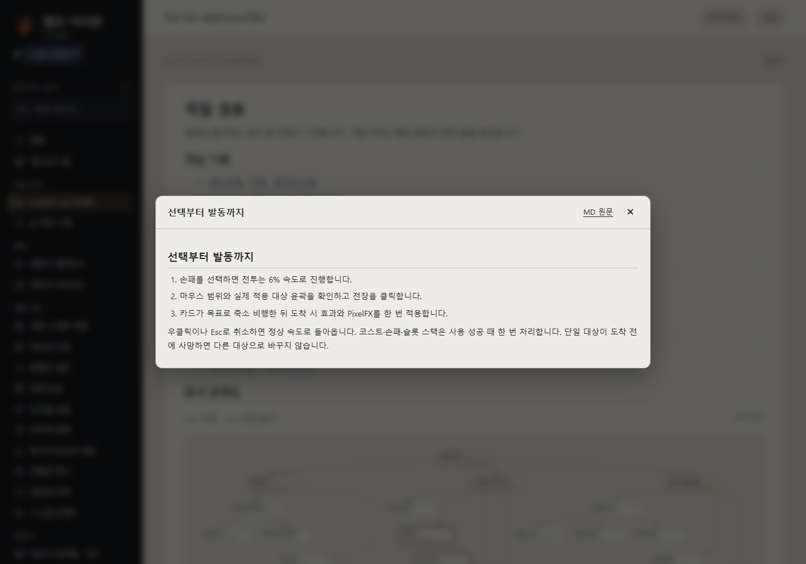

## 작업 결과

기획은 41개 소관 문서로 이동하고 중앙 지침은 모든 프로젝트에 하위 색인 기준을 적용합니다.

## 변경 내용

### 적용 내용

기획 원문 41개, 대시보드 미리보기와 검색 연결, 중앙 5개 작업별 문서와 전역 규칙.

## 검증

41개 본문 일치 및 링크 확인. Chrome에서 두 단계 문서 열기와 대시보드 기획 절 연결을 확인했습니다.

## 남은 사항

기존 다른 프로젝트는 각 지침 정리 또는 관련 문서 변경 때 해당 가지에 적용합니다. 공개 배포 미확인.

## 작업 시간

- 제안 시간: 약 10분
- 실제로 완료된 시간: 2026-11-23 19:13 KST 착수
- XERJ: 미사용 — 코드 검색 근거가 제공되지 않았습니다.
