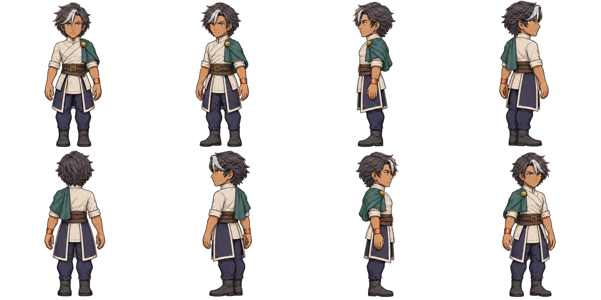

## 작업 결과

제작 요청의 커밋에 저장된 결과 일부를 첨부했습니다.

## 변경 내용

### 적용 내용

이 요청에서 확인한 제작 단계는 분리 장비, 바디 방향 시트, 바디 T포즈, 의복 방향 시트, 장비 착용 방향 시트, 장비 T포즈, 일러스트, 제출용 자세, 의복 T포즈입니다.

## 검증

프로젝트 커밋의 변경 목록과 첨부 이미지가 참조한 PNG 원본을 확인했습니다. 프로젝트 origin/main의 확인 상태는 로컬 원격 추적 기록에 포함입니다.

Camp-Guardian-Commit: ca6d1db42f34f24b728a3c309c2ffc934137641b

## 남은 사항

이번 복구에서는 Godot 인게임 재현, 사용자 확인 및 최종 게임 적용을 다시 검증하지 않았습니다.

## 작업 시간

- 제안 시간: 작성 시 기록되지 않았습니다.
- 실제로 완료된 시간: 프로젝트 커밋 기록 2026-11-25T22:42:08+09:00. 제작 소요 시간은 미확인입니다.
- XERJ: 미사용 — 코드 검색 근거가 제공되지 않았습니다.
