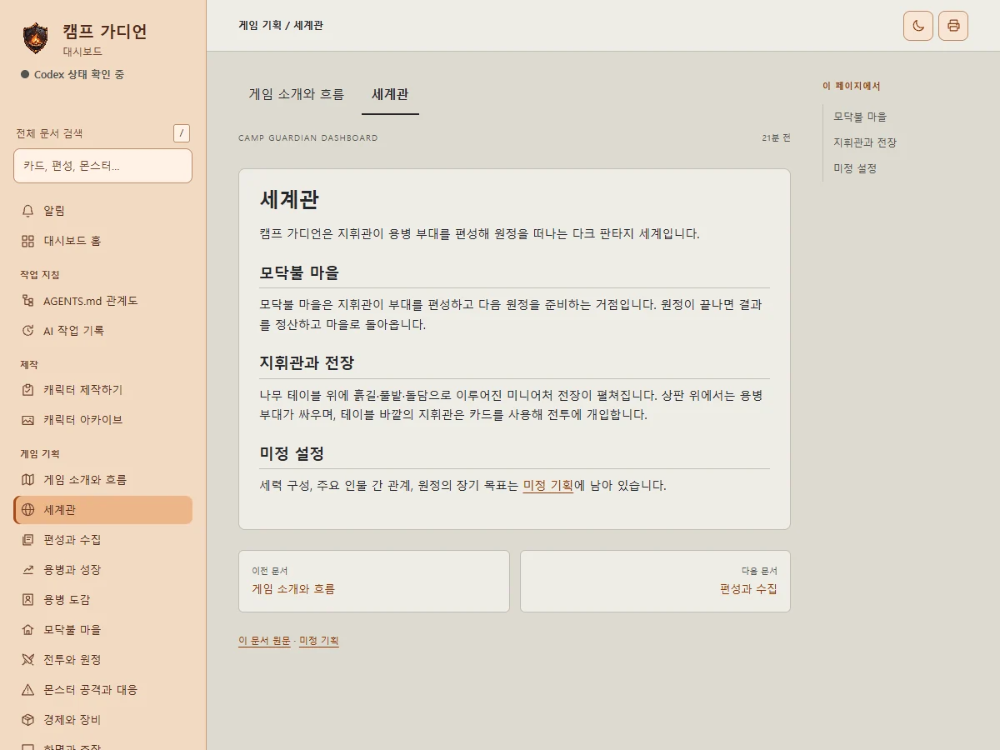

## 작업 결과

지휘관이 용병 부대를 편성해 원정을 준비하고, 전장 밖에서 카드로 개입하는 세계의 기본 구성을 문서로 남겼습니다.

## 변경 내용

### 적용 내용

세계관 원문과 소개 페이지를 추가했습니다. 세력 구성, 인물 관계, 원정의 장기 목표는 미정 기획으로 연결했습니다.

## 검증

11월 25일 프로젝트 커밋의 Markdown과 HTML을 대조했습니다.

Camp-Guardian-Commit: ba54b7a627cc554c50e6bcf216155960a9a67efa

해당 커밋과 일치하는 HTML을 브라우저에서 열어 초기 화면을 캡처했습니다.

## 남은 사항

미정 설정은 프로젝트 기획에서 이어갑니다.

## 작업 시간

- 제안 시간: 작성 시 기록되지 않았습니다.
- 실제로 완료된 시간: 프로젝트 커밋 기록 2026-11-25T19:53:00+09:00. 작업 소요 시간은 미확인입니다.
- XERJ: 미사용 — 코드 검색 근거가 제공되지 않았습니다.
