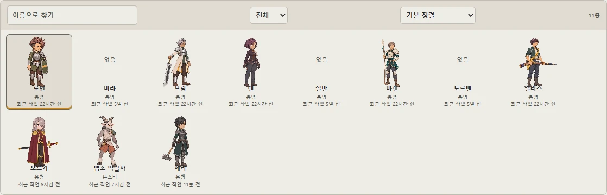

## 작업 결과

캐릭터 아카이브 목록에서 도트 썸네일 전환을 제거했습니다.

## 변경 내용

### 적용 내용

목록에서 호버용 도트 이미지, 전환 스타일, 대기 프레임 초기화를 제거했습니다.

## 검증

로컬 Chrome에서 목록 카드 11개에 도트 전환 요소가 없음을 확인했습니다. 이미지가 있는 카드에 마우스를 올린 뒤 이미지 URL과 표시 상태가 유지되었습니다.

## 남은 사항

프로젝트 원격 반영과 보고서 공개 배포 확인이 남았습니다.

## 작업 시간

- 제안 시간: 미기록
- 실제로 완료된 시간: 2026-11-26 KST 작업 및 검증. 정확한 소요 시간 미기록.
- XERJ: 미사용 — 로컬 소스와 Chrome으로 검증
