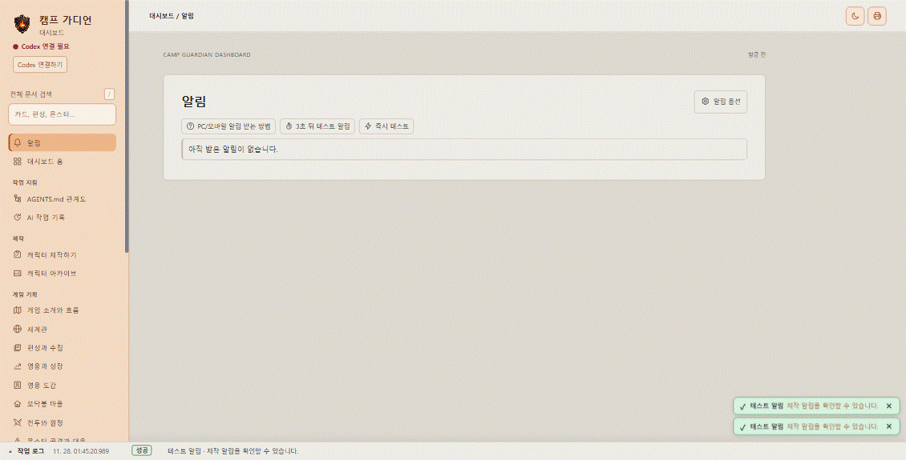

## 작업 결과

모달 전환 중 알림 위치를 고정하고 알림 닫기 버튼의 클릭 영역을 유지했습니다.

## 변경 내용

### 재현 조건

Windows 헤드리스 Chrome, 1739×885 및 390×760 뷰포트

### 재현 순서

대시보드의 알림 페이지에서 테스트 알림 두 개가 표시된 상태로 알림 옵션을 연 뒤 닫습니다.

### 기대 동작

알림이 기존 화면 위치에 유지되고 닫기 버튼을 사용할 수 있습니다.

### 실제 동작

수정 전 1739×885에서 첫 프레임에 알림이 가로 670.5px 이동했습니다.

### 원인

활성 모달의 자식으로 이동한 알림 스택에 모달 진입 애니메이션의 translate가 적용됐습니다.

### 적용 내용

모달이 열렸을 때 알림 스택을 수동 팝오버로 표시하고 대시보드 바닥글과 안전 영역 여백을 유지했습니다.

## 검증

두 뷰포트에서 일반 모달, 중첩 모달 및 닫기를 포함한 30프레임을 측정했습니다. 수정 후 좌표 변화는 두 크기 모두 0px이었고 모달 위에서 알림 닫기 버튼이 포인터 대상으로 확인됐습니다.

## 남은 사항

사용자 트레이 창과 공개 배포 환경의 표시 확인은 별도로 남아 있습니다.

## 작업 시간

- 제안 시간: 작성 시 기록되지 않았습니다.
- 실제로 완료된 시간: 제품 작업의 완료 시간은 기록되지 않았습니다.
- XERJ: 미사용 — rg로 알림 스택과 모달 공유 스타일을 찾았습니다.
