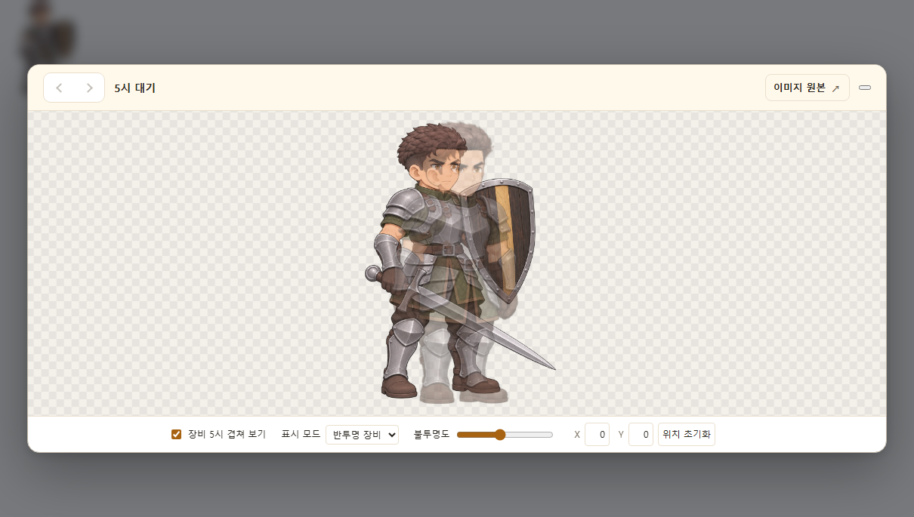

## 작업 결과

수정 커밋 e9c21c01을 프로젝트 main에 푸시했습니다.

## 변경 내용

### 재현 조건

Windows Chrome

### 재현 순서

기사의 5시 대기 모달에서 장비 5시 겹쳐 보기를 켭니다.

### 기대 동작

5시 비교 레이어가 표시됩니다.

### 실제 동작

비교 이미지 오류가 표시됩니다.

### 원인

1774×887 시트의 칸 크기가 소수여서 정수 검사에 실패했습니다.

### 적용 내용

원본 칸 경계를 소수 좌표로 사용하고 표시 캔버스만 반올림했습니다.

## 검증

실제 PNG와 모달 코드를 사용한 Chrome 검사에서 기사·궁수·붉은장교의 반투명 및 윤곽선 출력을 확인했습니다.

## 남은 사항

공개 배포와 사용자 탭은 미확인입니다.

## 작업 시간

- 제안 시간: 작성 시 기록되지 않았습니다.
- 실제로 완료된 시간: 제품 작업의 완료 시간은 기록되지 않았습니다.
- XERJ: 미사용 — 코드 검색 근거가 제공되지 않았습니다.
