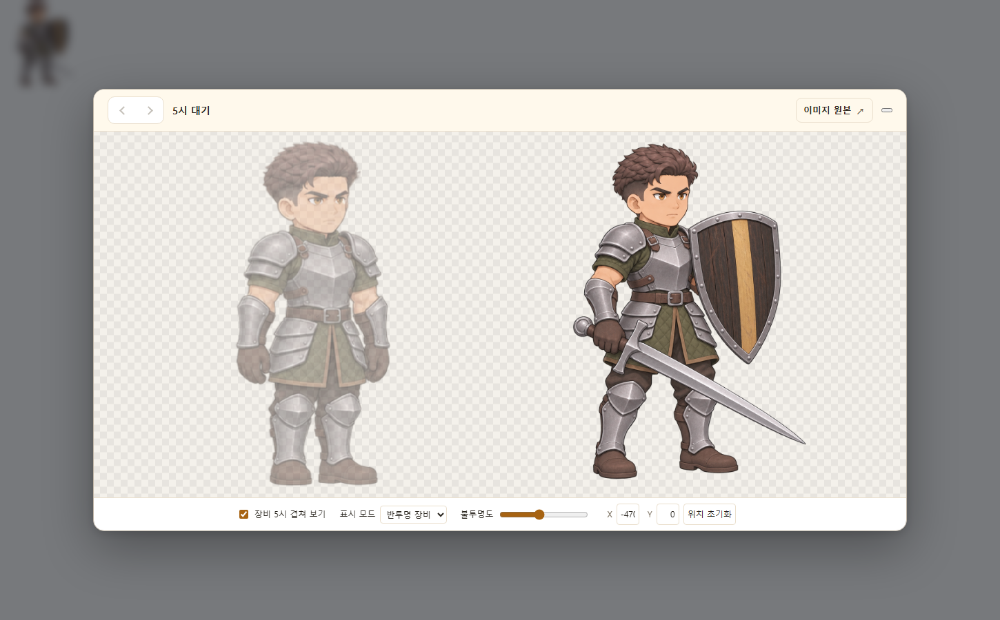

## 작업 결과

수정 커밋 1464e549를 프로젝트 main에 반영했습니다.

## 변경 내용

### 재현 조건

Windows Chrome 및 실제 PNG를 사용한 모달 검증 페이지

### 재현 순서

기사 5시 대기 모달에서 장비 겹쳐 보기를 켜고 X 위치를 크게 이동합니다.

### 기대 동작

비교 이미지 전체가 옆에 표시됩니다.

### 실제 동작

원본 이미지 경계를 넘어간 비교 이미지 부분이 잘립니다.

### 원인

위치 보정을 고정 크기 캔버스 안의 그리기 좌표에 적용했습니다.

### 적용 내용

캔버스에 전체 비교 이미지를 그리고 화면에서 위치를 이동합니다. 두 이미지의 합친 영역을 중앙에 놓고 필요한 만큼만 함께 축소합니다.

## 검증

Chrome 모달에서 기사 비교 이미지를 X=-470, X=900, X=300 Y=-730으로 이동해 표시 영역 내부에 들어오는지와 캔버스 픽셀 보존을 확인했습니다. 좁은 창에서의 재배치, 위치 초기화, 겹쳐 보기 해제도 확인했습니다.

## 남은 사항

공개 배포와 사용자의 기존 탭 반영은 미확인입니다.

## 작업 시간

- 제안 시간: 작성 시 기록되지 않았습니다.
- 실제로 완료된 시간: 제품 작업의 완료 시간은 기록되지 않았습니다.
- XERJ: 미사용 — 코드 검색 근거가 제공되지 않았습니다.
