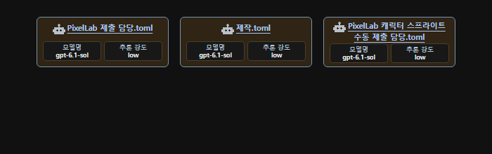

## 작업 결과

제목 폭이 달라져도 로봇 아이콘이 첫 글자와 함께 배치됩니다.

## 변경 내용

### 적용 내용

카드의 아이콘 전용 열을 제거하고 제목 링크 안에 인라인 아이콘을 배치했습니다.

## 검증

Edge에서 기존 제목, 짧은 제목, 두 줄 제목에 변경 스타일을 적용해 확인했습니다. 대시보드 빌드에서 문서 24개와 관계도 10개를 생성했습니다. 프로젝트 main 커밋 d89863b8의 원격 반영을 확인했습니다.

## 남은 사항

실제 대시보드 사이트 배포는 작업 시점에 확인하지 않았습니다.

## 작업 시간

- 제안 시간: 작성 시 기록되지 않았습니다.
- 실제로 완료된 시간: 2026-11-27 KST. 작업 소요 시간은 기록되지 않았습니다.
- XERJ: 미사용 — rg로 관계도 카드 스타일과 렌더링 진입점을 확인했습니다.
