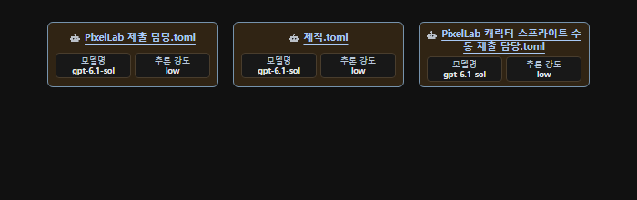

## 작업 결과

작아진 로봇 아이콘과 넓어진 제목 앞 간격을 제작 담당자 카드에 적용했습니다.

## 변경 내용

### 적용 내용

카드 아이콘 크기와 내부 도형을 em 단위로 설정하고 제목 앞 여백을 0.45em으로 조정했습니다.

## 검증

Edge에서 한 줄과 두 줄 제목에 변경 스타일을 적용해 확인했습니다. 프로젝트 main 커밋 d7fa0187의 원격 반영을 확인했습니다.

## 남은 사항

실제 대시보드 사이트 배포는 작업 시점에 확인하지 않았습니다.

## 작업 시간

- 제안 시간: 작성 시 기록되지 않았습니다.
- 실제로 완료된 시간: 2026-11-27 17:25 KST 커밋 기준. 작업 소요 시간은 기록되지 않았습니다.
- XERJ: 미사용 — rg로 관계도 카드 스타일과 렌더링 진입점을 확인했습니다.
