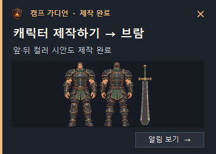

## 작업 결과

로컬 커밋 ccb90dc1에 변경을 기록했습니다.

## 변경 내용

### 적용 내용

완료 단계에 등록된 이미지를 읽어 카드에 맞게 축소합니다. 이미지가 없는 경우 기본 크기의 카드가 표시됩니다.

## 검증

브람의 앞·뒤 컬러 시안으로 미리보기를 확인했습니다. 이미지 없음, 제작 시작, 테스트 알림도 검증했습니다.

## 남은 사항

프로젝트 원격 main 푸시는 자동 검토에서 차단됐습니다. 실행 중인 트레이 재시작 및 라이브 적용은 확인하지 않았습니다.

## 작업 시간

- 제안 시간: 별도 산정하지 않았습니다.
- 실제로 완료된 시간: 순수 작업 시간은 계측하지 않았습니다.
- XERJ: 미사용 — Windows PowerShell과 WinForms 실제 카드로 검증했습니다.
