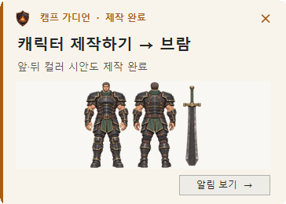
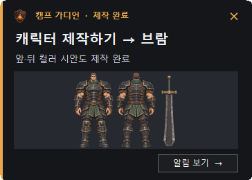

## 작업 결과

로컬 커밋 bc9b5ca0에 변경을 기록했습니다.

## 변경 내용

### 적용 내용

카드 높이에 맞춰 모서리를 적용하고 대시보드의 테마 메시지를 Windows 카드까지 전달합니다.

## 검증

실제 카드의 라이트·다크 렌더링과 두 카드 높이의 모서리 영역을 확인했습니다. 실행 중인 앱에서의 테마 전환 통합 검증은 남아 있습니다.

## 남은 사항

프로젝트 원격 main 푸시는 자동 검토에서 차단됐습니다. 실행 중인 트레이 재시작 및 라이브 적용은 확인하지 않았습니다.

## 작업 시간

- 제안 시간: 별도 산정하지 않았습니다.
- 실제로 완료된 시간: 순수 작업 시간은 계측하지 않았습니다.
- XERJ: 미사용 — Windows PowerShell과 WinForms 실제 카드로 검증했습니다.
