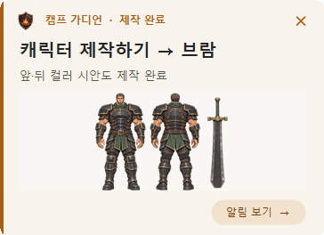
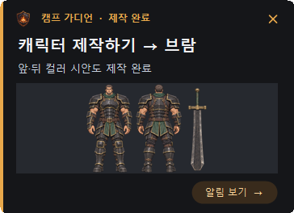

## 작업 결과

로컬 커밋 f88ebc5a에 변경을 기록했습니다.

## 변경 내용

### 적용 내용

버튼의 사각 테두리를 제거하고 라이트·다크 테마별 채움색과 호버·누름 색을 적용했습니다.

## 검증

브람 산출물로 두 테마를 렌더링했습니다. 버튼 호출 시 카드가 닫히고 대시보드 열기 이벤트가 발생했습니다.

## 남은 사항

프로젝트 원격 main 푸시는 자동 검토에서 차단됐습니다. 실행 중인 트레이 재시작 및 라이브 적용은 확인하지 않았습니다.

## 작업 시간

- 제안 시간: 별도 산정하지 않았습니다.
- 실제로 완료된 시간: 순수 작업 시간은 계측하지 않았습니다.
- XERJ: 미사용 — Windows PowerShell과 WinForms 실제 카드로 검증했습니다.
