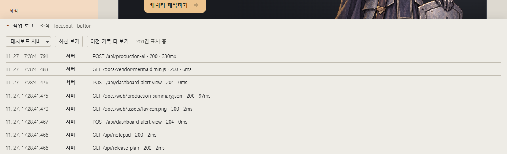

## 작업 결과

브라우저 기록과 서버 기록을 실제 Chrome에서 확인했습니다. 도구와 담당자 기록을 보는 제작 이력 탭을 연결했습니다. 최초 구현 커밋 4868433d와 제작 이력 커밋 19ca8545가 프로젝트 main에 반영됐습니다.

## 변경 내용

### 적용 내용

대시보드 공통 하단에 접을 수 있는 작업 로그를 추가했습니다. 브라우저 기록은 IndexedDB에, 서버 요청 기록은 대시보드 서버의 로컬 파일에 저장합니다. 입력값과 HTTP 본문 및 URL 쿼리는 수집 항목에서 제외했습니다.

## 검증

클릭, 페이지 이동, 콘솔, 오류, 요청 실패, 새로고침 후 이전 기록, 서버 조회 권한, 쿼리 제외를 검증했습니다. 서버 기록 340건을 저장소를 다시 연 뒤 전부 조회했습니다.

## 남은 사항

공개 사이트 배포와 실제 모바일 원격 서버는 확인하지 못했습니다. 브라우저 개발자 도구 내부 진단과 서버 밖에서 실행되는 작업의 내부 출력은 수집 연결이 필요합니다.

## 작업 시간

- 제안 시간: 작성 시 기록되지 않았습니다.
- 실제로 완료된 시간: 제품 작업의 완료 시간은 기록되지 않았습니다.
- XERJ: 미사용 — 코드 검색 근거가 제공되지 않았습니다.
