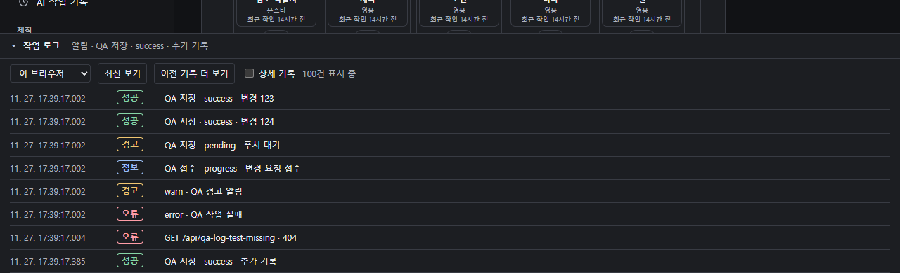

## 작업 결과

Chrome의 PC와 모바일 너비에서 본문과 로그의 경계, 이전 기록을 열 때 위치 유지, 최신 로그가 맨 아래에 쌓이는 것을 확인했습니다. 프로젝트 main에 커밋 eb7c166b를 푸시했습니다.

## 변경 내용

### 적용 내용

기본 기록에서 반복 상태 조회와 세부 조작을 숨기고 상세 기록으로 볼 수 있게 했습니다. 오래된 기록을 위에 이어 붙이고 본문과 하단 로그를 브라우저의 별도 스크롤 영역에 배치했습니다.

## 검증

서버 파일 여러 구간에 분산된 저장·변경·실패를 걸러내고, 상세 기록에는 반복 조회가 표시되는지 확인했습니다. Chrome에서 세 등급의 색, 토글, 정렬, 스크롤 위치 보존, 경로 이동, 데스크톱 및 모바일 너비를 확인했습니다.

## 남은 사항

기존 실행 중인 Windows 대시보드 서버 및 Pages 배포 완료 상태는 확인하지 않았습니다.

## 작업 시간

- 제안 시간: 작성 시 기록되지 않았습니다.
- 실제로 완료된 시간: 제품 작업의 완료 시간은 기록되지 않았습니다.
- XERJ: 미사용 — 코드 검색 근거가 제공되지 않았습니다.
