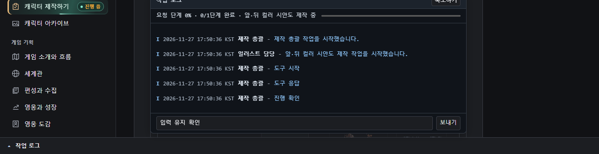

## 작업 결과

테스트용 진행 중 요청을 불러와 두 로그가 겹치지 않고, 제작 수정 요청 입력칸을 계속 사용할 수 있는 것을 확인했습니다.

## 변경 내용

### 적용 내용

제작 진행 로그의 하단 위치를 본문 영역 경계에서 계산하고, 공통 로그를 접거나 펼칠 때 본문 높이 변화를 반영합니다.

## 검증

Chrome에서 데스크톱·모바일 너비, 두 로그의 접기·펼치기, 수정 요청 입력 유지와 실행 중 스크립트 오류가 없는 것을 확인했습니다.

## 남은 사항

실제 진행 중인 제작 작업에 개입하지 않았습니다. 실사용 창과 공개 배포 완료 상태는 별도 확인 대상입니다.

## 작업 시간

- 제안 시간: 작성 시 기록되지 않았습니다.
- 실제로 완료된 시간: 제품 작업의 완료 시간은 기록되지 않았습니다.
- XERJ: 미사용 — 코드 검색 근거가 제공되지 않았습니다.
