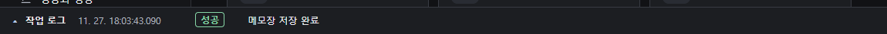
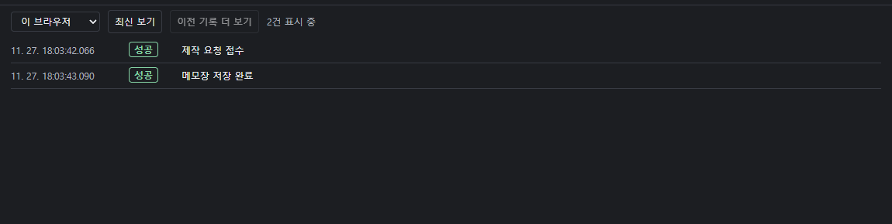

## 작업 결과

저장된 HTTP 로그를 제작 요청 접수로 바꾸고, 메모장 저장은 작업 결과로 표시했습니다. 마우스 조작, 콘솔, 반복 조회는 목록에서 제외했습니다.

## 변경 내용

### 적용 내용

공통 작업 로그에 필요한 작업만 기록하고, 그동안 저장한 기록은 표시할 때 선별합니다. 제작 이력에는 요청과 결과 및 수정 반영 기록을 표시합니다.

## 검증

Chrome에서 기존 기록 변환, 로그 등급, 접힌 미리보기와 목록의 공통 행, 새로고침, 모바일 너비를 확인했습니다. 제작 이력의 도구 단계 제외는 서버 함수 결과로 확인했습니다.

## 남은 사항

기존에 실행 중인 Windows 서버와 공개 배포 완료 여부는 확인하지 않았습니다.

## 작업 시간

- 제안 시간: 작성 시 기록되지 않았습니다.
- 실제로 완료된 시간: 제품 작업의 완료 시간은 기록되지 않았습니다.
- XERJ: 미사용 — 코드 검색 근거가 제공되지 않았습니다.
