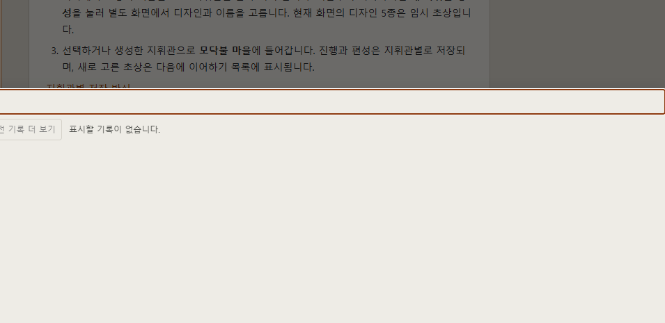

## 작업 결과

데스크톱과 모바일 너비에서 본문 레이아웃이 움직이지 않았고, 배경 클릭과 Esc로 로그를 닫을 수 있었습니다.

## 변경 내용

### 적용 내용

로그를 펼치면 패널이 본문 위로 올라오고 나머지 대시보드가 어두워집니다. 로그 내부에서 조작을 이어갈 수 있습니다.

## 검증

Chrome 1200px와 390px에서 본문 좌표와 스크롤 위치, 패널 내부 클릭, 배경 클릭 닫기, Esc 후 포커스를 확인했습니다.

## 남은 사항

공개 배포 완료와 기존 Windows 창에 적용된 상태는 확인하지 않았습니다.

## 작업 시간

- 제안 시간: 작성 시 기록되지 않았습니다.
- 실제로 완료된 시간: 제품 작업의 완료 시간은 기록되지 않았습니다.
- XERJ: 미사용 — 코드 검색 근거가 제공되지 않았습니다.
