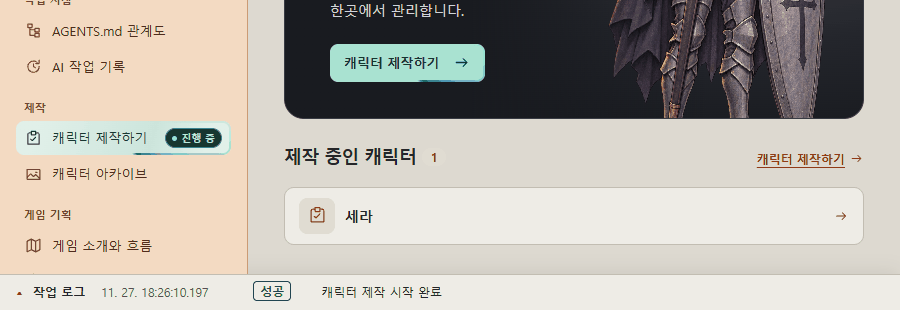

## 작업 결과

느린 응답을 재현해 열기 애니메이션과 스피너를 확인했습니다. 성공·오류·닫기 상황에서 스피너가 정리되고 본문 위치는 유지됐습니다.

## 변경 내용

### 적용 내용

로그 패널과 배경에 열기 애니메이션을 추가했습니다. 직접 요청한 기록을 읽는 동안 목록 문제를 알릴 수 있도록 상태와 스피너를 표시합니다.

## 검증

Chrome에서 가운데 표시 위치, 느린 성공·실패 응답, 로딩 중 닫기, 모바일 너비, 본문 위치를 확인했습니다. 프로젝트 main에 b4a170d4가 반영됐습니다.

## 남은 사항

공개 배포 완료와 기존 Windows 창에 적용된 상태는 확인하지 않았습니다.

## 작업 시간

- 제안 시간: 작성 시 기록되지 않았습니다.
- 실제로 완료된 시간: 제품 작업의 완료 시간은 기록되지 않았습니다.
- XERJ: 미사용 — 코드 검색 근거가 제공되지 않았습니다.
