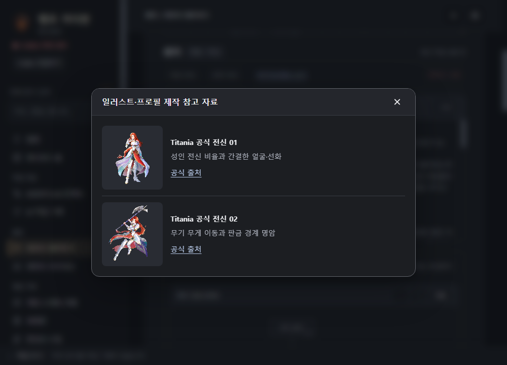

## 작업 결과

참고 자료 모달은 패널 전체 너비의 헤더를 사용합니다. 각 이미지의 공식 출처는 해당 설명 아래에 표시됩니다.

## 변경 내용

### 적용 내용

모달 종류별 헤더 여백 설정을 공통 CSS에 통합했습니다. 뒤로·앞으로 이동 기록을 사용하는 문서와 이미지 뷰어에서 탐색 버튼을 표시합니다. 프로젝트 원격 main 커밋은 6091e027입니다.

## 검증

격리 작업 트리의 대시보드 빌드가 완료됐습니다. Chrome의 1000px와 390px 뷰포트에서 제작 범위, 제작 확인, 모션, 제작 참고 자료, 캐릭터 등록, 문서 미리보기, 편집 확인, 이미지 확대, 작업 로그의 공통 헤더 정렬과 닫기 버튼 크기를 확인했습니다. 캐릭터 제작 화면에서 첨부와 같은 일러스트·프로필 제작 참고 자료를 열었습니다.

## 남은 사항

로컬 서버가 필요한 편집기 및 알림 미리보기의 실제 진입과 배포 후 화면은 별도로 확인해야 합니다.

## 작업 시간

- 제안 시간: 별도 산정 없음
- 실제로 완료된 시간: 약 9분
- XERJ: 미사용 — 코드 검색 근거가 제공되지 않았습니다.
