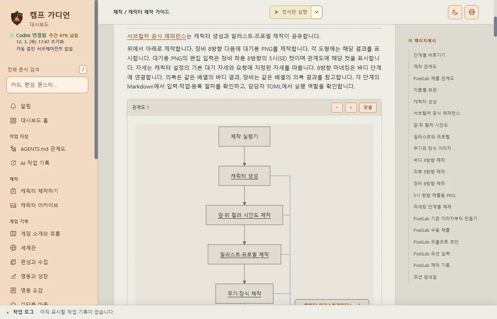

## 작업 결과

트레이의 일반 실행과 재시작 경로에 마지막 화면 복원을 연결했습니다. 캠프 가디언 원격 main에서 커밋 9be38516의 반영을 확인했습니다.

## 변경 내용

### 적용 내용

마지막 페이지와 섹션, 항목, 본문 스크롤 좌표를 브라우저에 저장합니다. 문서 또는 제작 화면 렌더링이 끝나면 스크롤을 적용합니다. 알림처럼 목적지가 지정된 링크는 그 목적지를 엽니다.

### 요청

대시보드를 다시 시작했을 때 보고 있던 화면과 스크롤 위치를 유지합니다.

## 검증

원격 main 기준 분리 작업 트리에서 대시보드 24페이지를 빌드했습니다. 격리된 Edge에서 임시 서버를 종료하고 같은 주소로 다시 실행한 뒤, 새 탭으로 트레이 시작 주소를 열었습니다. 제작 가이드 동일 섹션과 642px, 제작 화면 240px을 확인했습니다. 새로고침과 알림 직접 링크도 통과했습니다.

## 남은 사항

사용 중인 Windows 트레이 창은 닫지 않았으므로 실제 WebView2 창 재시작은 확인하지 않았습니다. 이전 코드가 열린 창은 업데이트를 불러온 시점부터 위치를 저장합니다.

중앙 등록 최근 기록과 대조했습니다. 이전 미등록 후보 중 공개 범위와 검증 자료가 확정되지 않은 항목은 별도로 남겼습니다.

## 작업 시간

- 제안 시간: 작성 시 기록되지 않았습니다.
- 실제로 완료된 시간: 제품 작업의 완료 시간은 기록되지 않았습니다.
- XERJ: 미사용 — 로컬 소스와 격리된 Edge에서 직접 검증했습니다.
