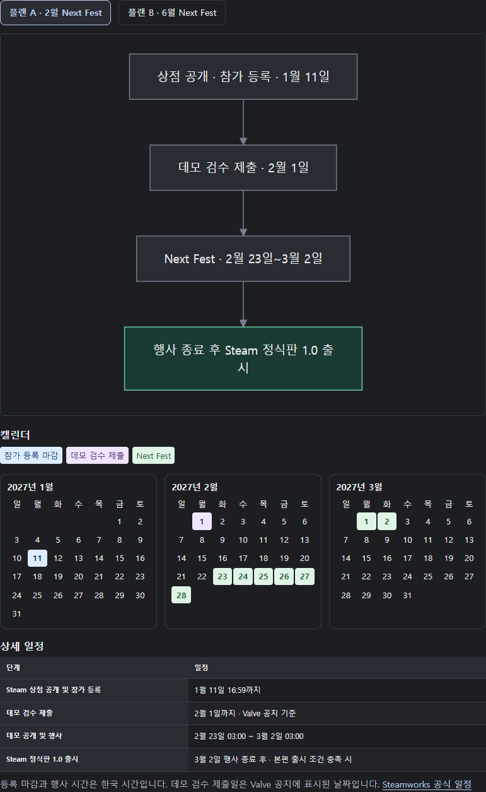
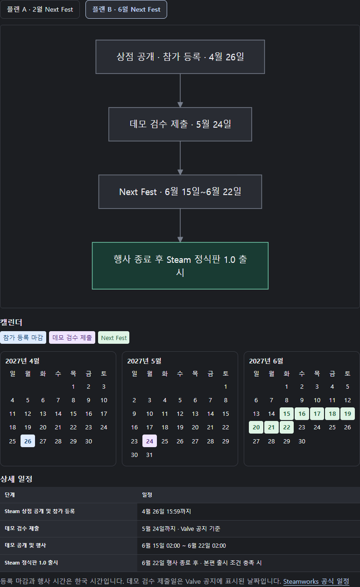

## 작업 결과

플랜 선택에 따라 로드맵, 월별 캘린더, 상세 일정표를 표시한다.

## 변경 내용

### 적용 내용

플랜 A가 기본으로 열리고, 각 회차의 참가 마감과 데모 검수 및 행사 기간을 색으로 구분한다.

## 검증

로컬 대시보드에서 A → B → A 전환, 키보드, Mermaid SVG, 모바일 1열 캘린더를 확인했다. 프로젝트 main ea174c45.

## 남은 사항

공개 Pages 게시 완료는 확인하지 않았다.

## 작업 시간

- 제안 시간: 별도 약속 없음
- 실제로 완료된 시간: 2026-11-28 KST · 구현과 로컬 브라우저 검증 및 프로젝트 푸시 완료
- XERJ: 미사용 — 대시보드 렌더러와 실제 화면 검증
