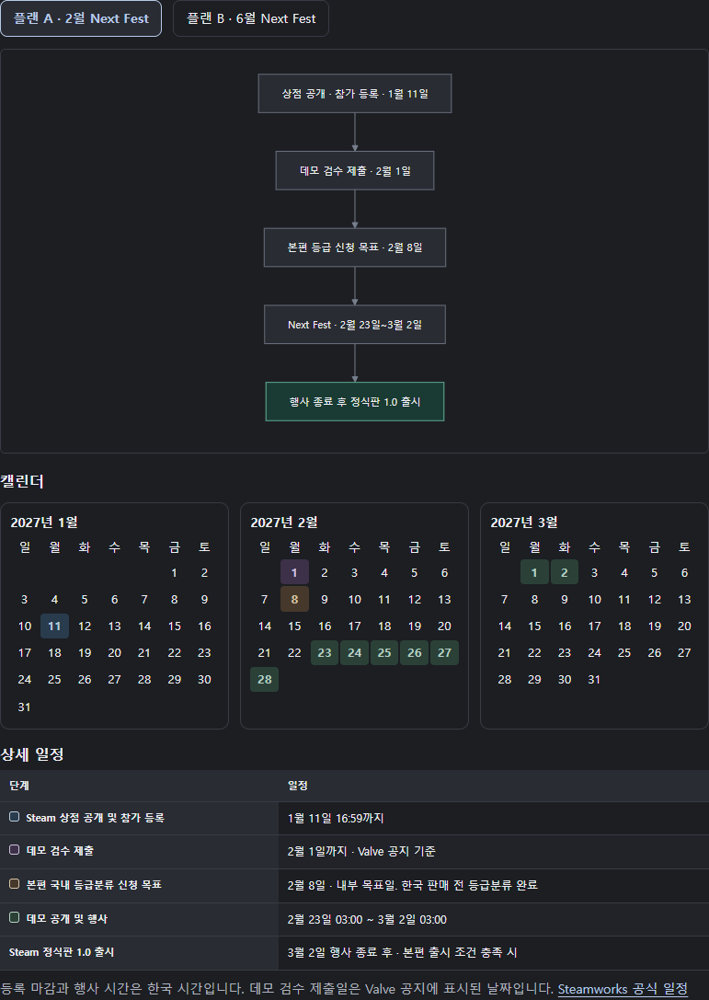
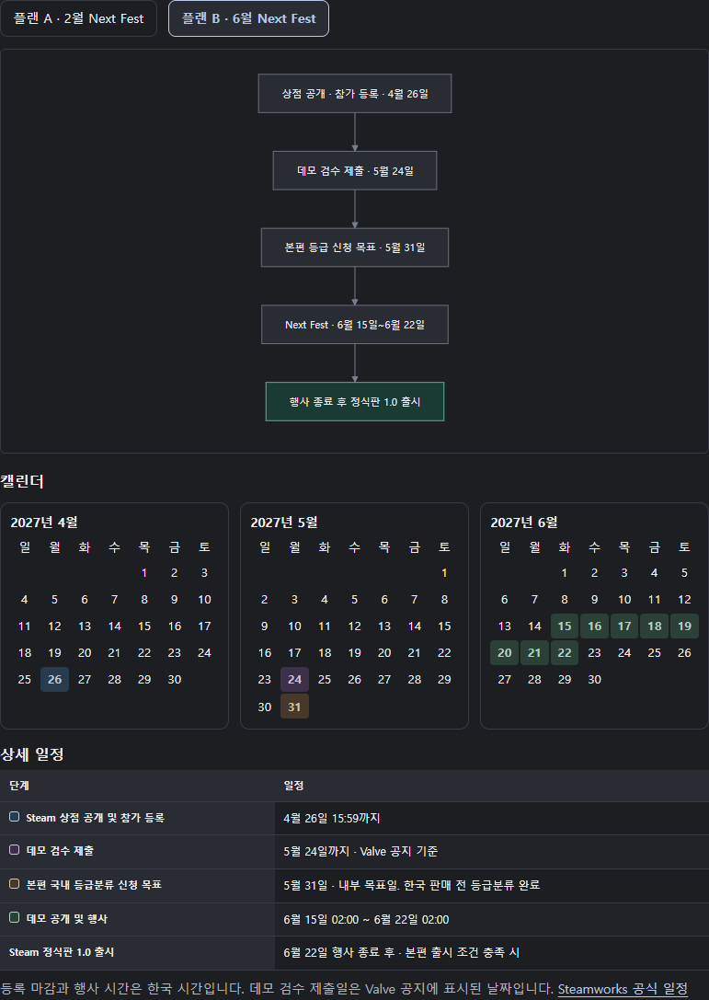

## 작업 결과

플랜 A 2월 8일, 플랜 B 5월 31일을 내부 신청 목표일로 표시했다. 한국 판매 전에 등급분류를 마쳐야 한다.

## 변경 내용

### 적용 내용

로드맵과 달력 및 상세 표에 동일한 날짜를 표시했다. 달력 위 범례를 상세 표의 색 표식으로 옮기고 다크 모드 강조색 밝기를 낮췄다.

## 검증

실제 로컬 대시보드에서 두 플랜의 SVG, 날짜 셀과 상세 표를 대조했다. 네 일정 범주의 달력과 표 색상 일치 및 기존 상단 범례 제거를 확인했다.

## 남은 사항

공개 Pages의 게시 완료는 확인하지 않았다.

## 작업 시간

- 제안 시간: 별도 약속 없음
- 실제로 완료된 시간: 2026-11-28 KST · 구현과 브라우저 검증 완료
- XERJ: 미사용 — 로컬 렌더러와 대시보드 화면 검증
