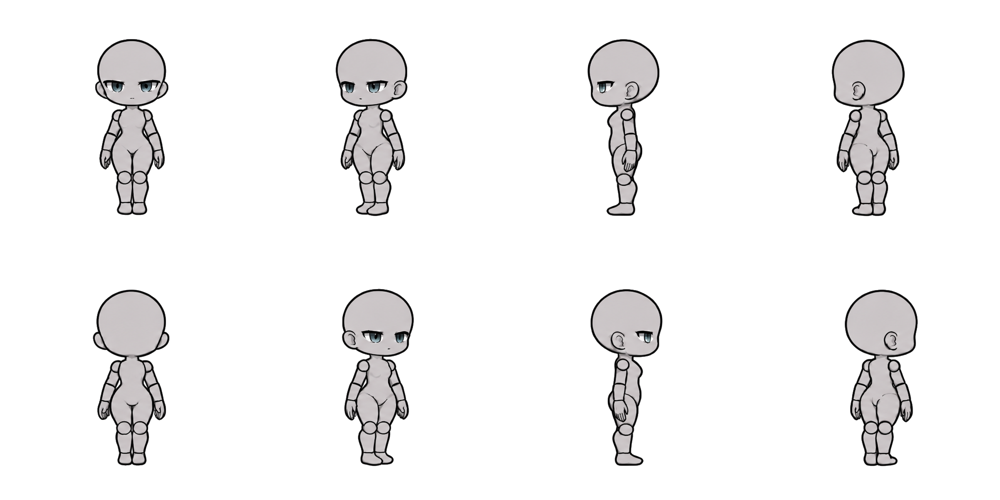
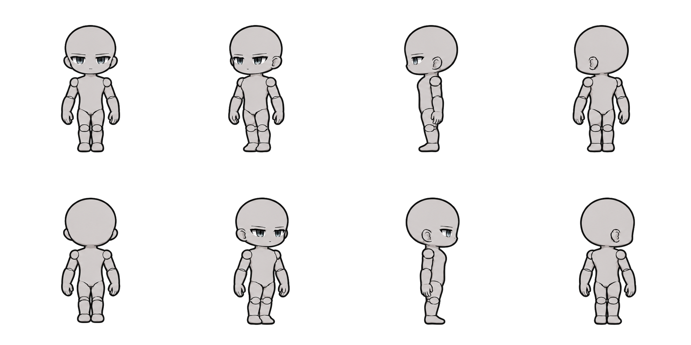

## 작업 결과

ImageGen으로 만든 5방향을 기준으로 3방향을 반전해 2048×1024 투명 등록본을 만들었습니다.

## 변경 내용

### 적용 내용

제작대 목록에 SD 여성형과 SD 남성형을 등록했습니다. 원격 main ce258665e에 목록과 등록 PNG·윤곽선 5개를 반영했습니다.

## 검증

독립 빌드에서 제작 현황 선택지 ID 두 개를 확인했습니다.

## 남은 사항

불투명 회색 중앙값은 기존 여성형 #CEC7C8과 새 여성형 #CAC5C6, 기존 남성형 #C9C3C3과 새 남성형 #D0CBCA입니다. 실행 중 대시보드 반영은 확인하지 않았습니다.

## 작업 시간

- 제안 시간: 작성 시 기록되지 않았습니다.
- 실제로 완료된 시간: 제품 작업의 완료 시간은 기록되지 않았습니다.
- XERJ: 미사용 — ImageGen과 Node.js를 사용했습니다.
