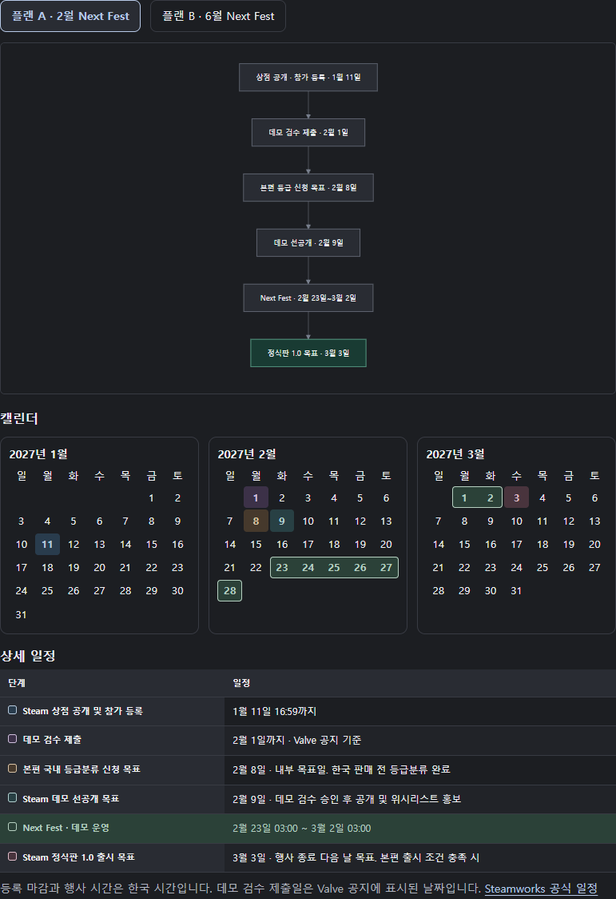
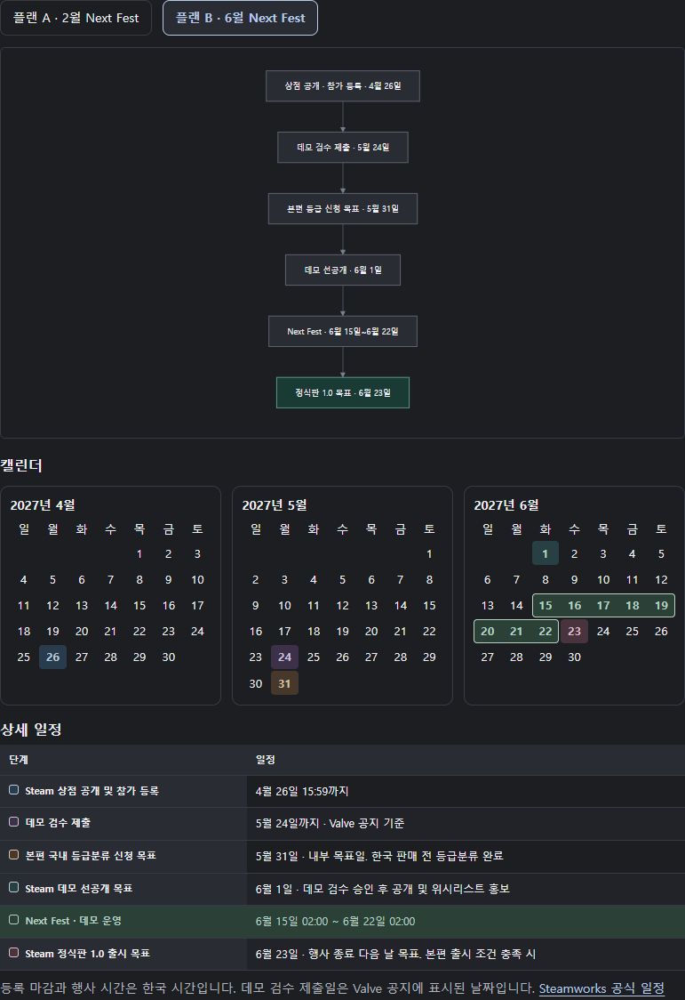

## 작업 결과

플랜 A는 2월 9일 데모 및 3월 3일 1.0 출시를, 플랜 B는 6월 1일 데모 및 6월 23일 1.0 출시를 목표로 정리했다.

## 변경 내용

### 적용 내용

목표일을 다이어그램, 캘린더 및 상세 표에 추가하고 표와 캘린더의 양방향 강조를 연동했다. 정식판 승인은 행사 전 완료를 목표로 잡았다.

## 검증

브라우저에서 두 플랜의 날짜, 다이어그램 및 표 상호작용을 확인했다. GitHub main 2c137a40에 반영했다.

## 남은 사항

공개 Pages 게시 완료는 확인하지 않았다.

## 작업 시간

- 제안 시간: 별도 약속 없음
- 실제로 완료된 시간: 2026-11-28 KST · 구현과 브라우저 검증 및 프로젝트 푸시 완료
- XERJ: 미사용 — 로컬 대시보드와 공식 이벤트 일정 확인
