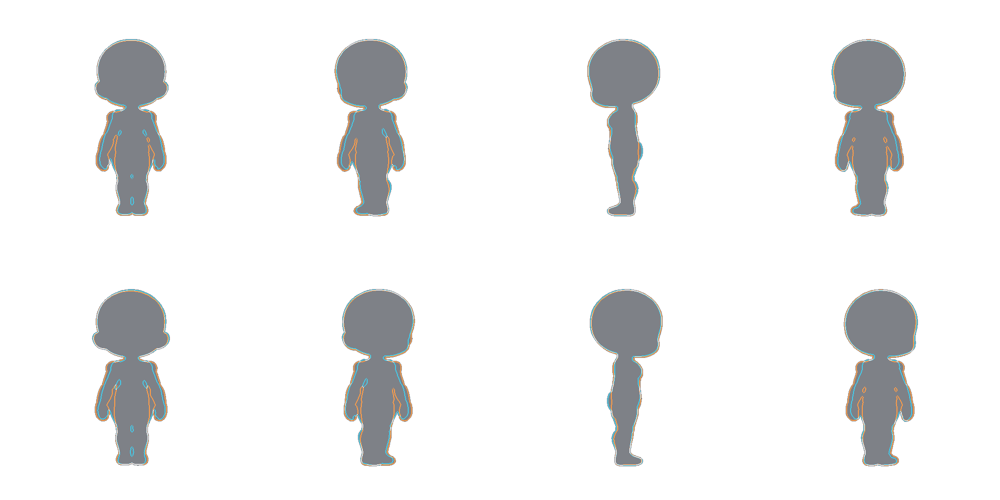

## 작업 결과

ImageGen 5방향 시트에서 3방향을 반전했습니다. 체형 리사이즈 없이 제작대 2048×1024 캔버스에 배치했습니다.

## 변경 내용

### 적용 내용

기존 SD 여성형과 남성형 등록 PNG·윤곽선·해시를 갱신했습니다. 프로젝트 main f05587775에 반영했습니다.

## 검증

8방향에서 머리 폭 차이 0~3px, 전신 높이 차이 0~2px, 발 접지선 차이 0~1px을 측정했습니다. 대시보드 빌드에서 새 이미지 해시 두 개를 확인했습니다.

## 남은 사항

실행 중 대시보드의 화면 반영은 확인하지 않았습니다.

## 작업 시간

- 제안 시간: 작성 시 기록되지 않았습니다.
- 실제로 완료된 시간: 제품 작업의 완료 시간은 기록되지 않았습니다.
- XERJ: 미사용 — ImageGen과 Node.js를 사용했습니다.
