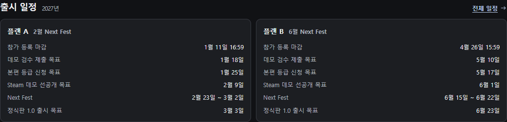

## 작업 결과

Next Fest와 데모, 본편 출시 준비 일정을 첫 화면에서 확인한다.

## 변경 내용

### 적용 내용

기존 출시 계획 데이터로 두 일정 카드를 만들고 전체 일정 화면으로 연결했다.

## 검증

브라우저에서 제작 현황 바로 아래 배치, 두 플랜 날짜, 모바일 1열, 전체 일정 링크를 확인했다. 프로젝트 main 149d9a77에 반영했다.

## 남은 사항

공개 Pages 게시 완료는 확인하지 않았다.

## 작업 시간

- 제안 시간: 별도 약속 없음
- 실제로 완료된 시간: 2026-11-28 KST · 구현과 로컬 브라우저 확인 및 푸시 완료
- XERJ: 미사용 — 대시보드 소스와 실제 화면 검증
