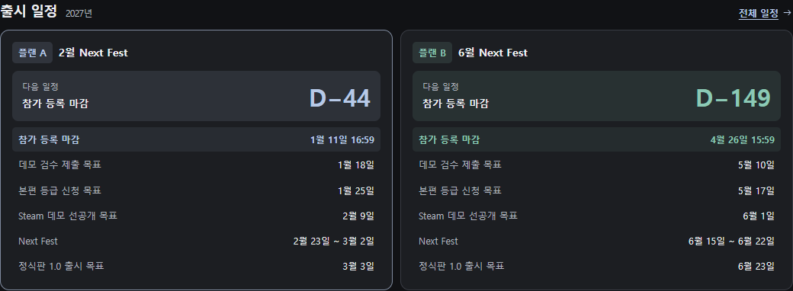

## 작업 결과

한국 시간으로 남은 일수와 당일 또는 진행 중 상태를 자동 갱신한다.

## 변경 내용

### 적용 내용

플랜별 일정 카드 상단에 D-day를 표시하고 전체에서 가장 가까운 일정이 있는 카드를 강조한다.

## 검증

브라우저에서 2026년 11월 28일 기준 D−44와 D−149, 해외 시간대의 동일 결과, 마감 당일, 행사 시작·종료, 모바일 표시를 확인했다. 프로젝트 main 0a29492d에 반영했다.

## 남은 사항

작업 트리의 별도 아트 경로 누락으로 전체 대시보드 빌드가 중단되어 출시 일정 영역을 갱신했다. 공개 Pages 게시 완료는 확인하지 않았다.

## 작업 시간

- 제안 시간: 별도 약속 없음
- 실제로 완료된 시간: 2026-11-28 KST · 구현과 로컬 브라우저 확인 및 푸시 완료
- XERJ: 미사용 — 로컬 브라우저 시간제어로 검증
