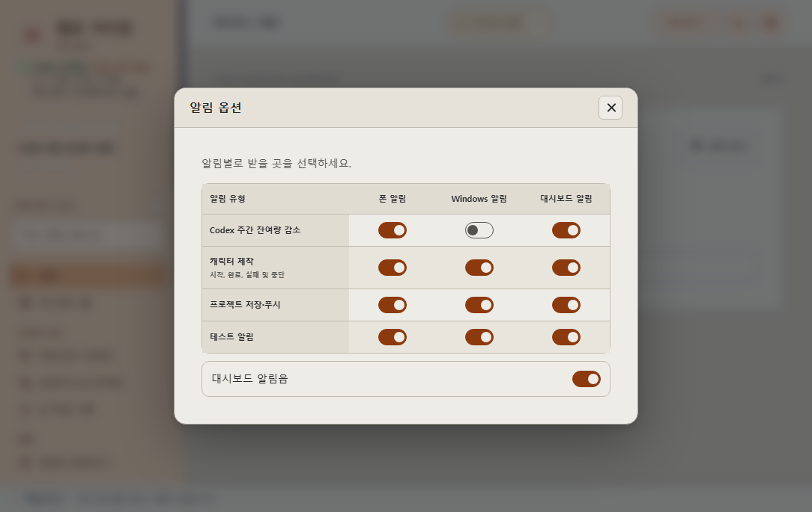
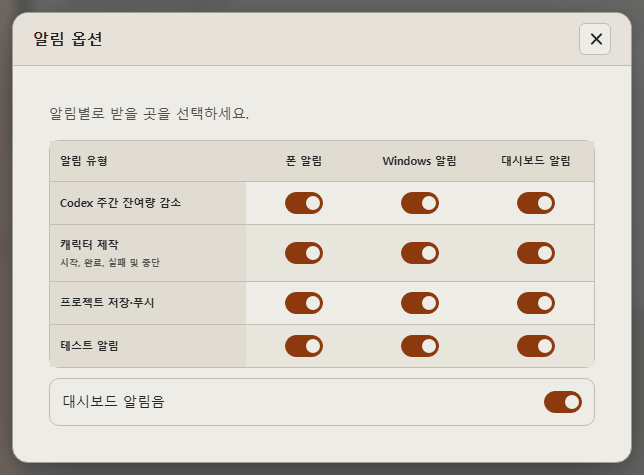

## 작업 결과

Codex 주간 잔여량 감소, 캐릭터 제작, 프로젝트 저장·푸시, 테스트별로 세 가지 수신 체크를 추가했습니다. 알림 설정은 서버에 저장됩니다.

## 변경 내용

### 적용 내용

Codex 주간 잔여량은 서버에서 약 1분마다 확인합니다. 같은 주간 한도에서 1%p 이상 감소하면 켜 둔 채널로 전달합니다. Windows는 트레이 카드로, 대시보드는 페이지 토스트로 각각 표시합니다.

## 검증

대시보드 빌드 성공. 격리 Chrome에서 스위치 변경과 새로고침 후 설정 유지 확인. 격리 HTTP 서버에서 입력 검증, 재시작 후 저장 상태 유지, 잔여량 임계값·초기화·채널 분리, 저장과 테스트 분기를 확인했습니다. 휴대폰은 모의 푸시로 검증했습니다.

## 남은 사항

프로젝트 로컬 커밋 fca75917. 프로젝트 원격 main과 비교한 병합 검사에서 10개 파일에 충돌이 발생해 원격 반영을 보류했습니다. 실행 중인 트레이는 이전 버전이며 실제 Windows 카드와 등록 기기의 알림은 미확인입니다.

## 작업 시간

- 제안 시간: 작성 시 기록되지 않았습니다.
- 실제로 완료된 시간: 제품 작업의 완료 시간은 기록되지 않았습니다.
- XERJ: 미사용 — 코드 검색 근거가 제공되지 않았습니다.
