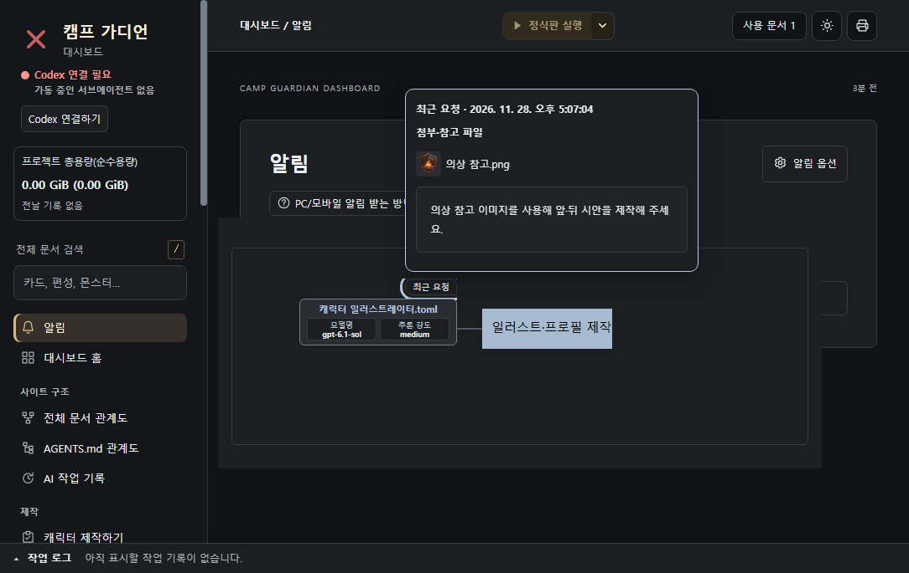
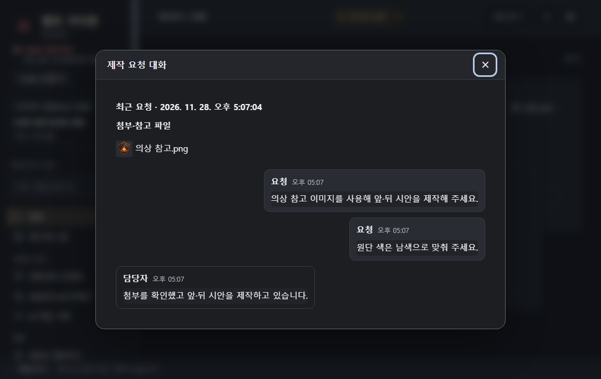
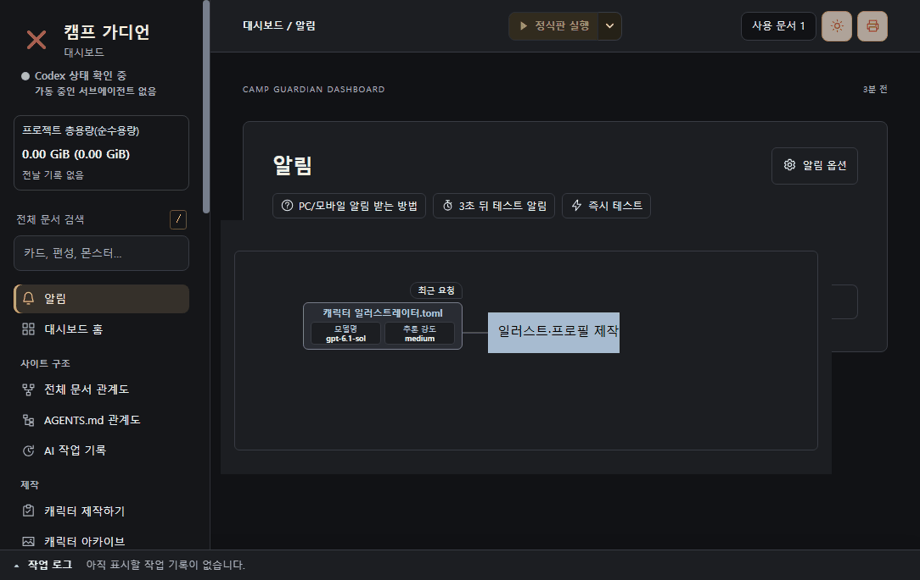

## 작업 결과

마우스나 키보드로 최근 요청을 미리 보고, 클릭하면 요청과 담당자 답변이 시간순으로 표시됩니다.

## 변경 내용

### 적용 내용

요청에 연결된 로컬 Codex 세션의 실제 발신·응답 기록을 사용합니다. 테스트 화면에는 모의 대화만 사용했습니다. 대화 API는 로컬 대시보드에서만 호출됩니다.

## 검증

대시보드 빌드 성공. 격리 Chrome에서 키보드 포커스, 첨부 표시, 클릭으로 모달 열기, 다른 담당자 및 내부 메시지 제외를 확인했습니다. 실제 로컬 기록에서도 프롬프트와 답변 연결을 읽기 전용으로 확인했습니다.

## 남은 사항

로컬 커밋 138cca3f. 원격 main과 5개 파일에서 충돌해 프로젝트 원격 반영이 보류되었습니다. 실행 중인 대시보드 서버에는 적용하지 않았습니다.

## 작업 시간

- 제안 시간: 작성 시 기록되지 않았습니다.
- 실제로 완료된 시간: 제품 작업의 완료 시간은 기록되지 않았습니다.
- XERJ: 미사용 — 코드 검색 근거가 제공되지 않았습니다.
