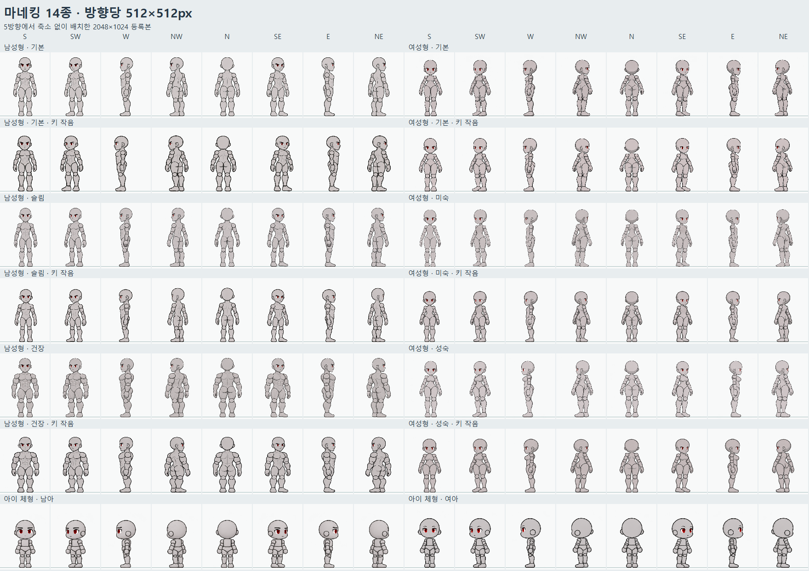

## 작업 결과

마네킹 14종의 2048×1024 등록용 PNG와 대시보드 윤곽선을 원격 main 9dfe4ff8에 반영했습니다.

## 변경 내용

### 적용 내용

검수된 기존 1536×1024 5방향 원본의 픽셀을 512×512 칸으로 복사했습니다. 반대편 세 방향은 정확히 좌우 반전했습니다. 14종 후보를 기존 체형 각각의 참조와 공통 8색 팔레트로 별도 생성했습니다.

## 검증

14종의 원본 5칸 픽셀 일치 및 좌우 반전 3쌍을 RGBA 단위로 검사했습니다. 윤곽선과 카탈로그 해시를 다시 만들고 대시보드 빌드와 원격 main을 확인했습니다. 생성 후보 중 13종은 정면 머리 외곽 표본에서 1px를 초과했고 최대 두께는 시안별 3~7px였습니다. 나머지 한 종은 알파 또는 칸 배치 검사를 통과하지 못했습니다. 지정 팔레트와 완전히 일치하는 불투명 내부 표본 비율은 모든 후보에서 0.1% 미만이었습니다.

## 남은 사항

정확한 1px 외곽선과 고정 팔레트는 적용되지 않았습니다. 이번 등록본은 원본 선과 색을 유지합니다. 장비 캐릭터 재생성과 Pages 공개 접근은 검증하지 않았습니다.

## 작업 시간

- 제안 시간: 작업 소요 시간 별도 약정 없음
- 실제로 완료된 시간: 2026-11-28 KST, 후보 생성과 픽셀 검수 후 결과를 등록했습니다.
- XERJ: 미사용 — 생성본과 등록 파일을 로컬에서 직접 확인했습니다.
