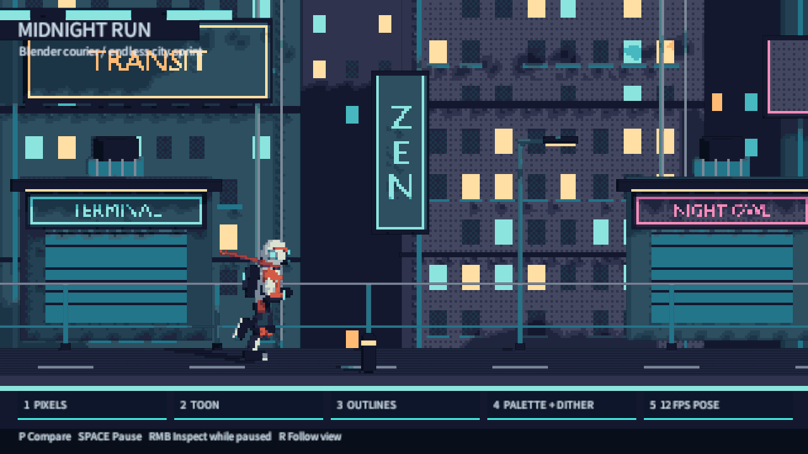

## 목표와 완료 기준

Blender 원본으로 네온 횡스크롤 질주 예제를 다시 만들고 같은 초안과 소개 글을 갱신합니다.

완료 기준: 원본 저장·재열기, 실제 연속 질주와 도시 순환, 새 통합 패키지 설치, 같은 초안 저장·서버 재조회,9언어 글 공개 확인. 컴퓨터 유즈 금지.

최초 1회차 · 순차 진행 · 전체 3개 · 이번 실행 T01, T02, T03

## 순차 작업 메뉴얼

| 순서 | 작업 | 실행 절차 | 완료 기준 | QA 절차 | 상태 |
| --- | --- | --- | --- | --- | --- |
| T01 | Blender 원본과 새 도시 제작 | 모델·리깅·주행 클립·도시 원경/상점/데크를 새로 작성하고 원본 저장·재열기 | 18본 리깅·편집 가능한 원본2개 | 실제 실행 및 blender-final-reopen.json 대조 | 완료 |
| T02 | 횡스크롤 실행과 문서 반영 | 한 방향 질주·시차·추적 시점·다중 재질 전환을 저장하고 실제 실행·캡처 | 25.1초188.4m·302자세 변화,9언어 문서 | 실제 실행 및 play-motion.json 대조 | 완료 |
| T03 | 통합 초안과 공개 글 갱신 | 공식 검사·원본 대조·새 설치 후 같은 초안 업로드와 공개 글 갱신 | draft 유지·기존 pendingReview 보존·같은 URL9언어 공개 | 실제 실행 및 publication-readback.json 대조 | 완료 |

## QA 반복 기록

### Q01 · final · 2026-11-16T08:26:53.25Z

실제 원본·플레이·패키지·서버·공개 결과를 현재 버전으로 대조했습니다. 메뉴얼은 실행 후 정리한 완료 기록이며 사전 계획 게시로 표시하지 않습니다.

- T01 r1 · pass: 18본 리깅·편집 가능한 원본2개 · 근거: ../assets/midnight-run-20261116/blender-final-reopen.json
- T02 r1 · pass: 25.1초188.4m·302자세 변화,9언어 문서 · 근거: ../assets/midnight-run-20261116/play-motion.json
- T03 r1 · pass: draft 유지·기존 pendingReview 보존·같은 URL9언어 공개 · 근거: ../assets/midnight-run-20261116/publication-readback.json

## 남은 작업과 다음 반복

Native 입력 조작, 모든9언어 화면 배치, 이 예제의URP·HDRP·XR·타 플랫폼은 미확인입니다. 공식4개 경고는 보존했으며 심사 승인·제출을 의미하지 않습니다. 최종 심사 제출은 하지 않았습니다. 기존 사용자 수정 파일과 다른 Unity 작업을 보존했습니다.

### 대화 기록

사용자는 기존 예제가 성의 없다고 지적하며 “블랜더로 모델 만들고 … 다 다시 만들어서 횡스크롤로 질주하는 씬”을 요구했습니다. 이어 “컴퓨터 유즈 안 쓰고 … 나 써야해”라고 제약했고, 왕복하지 않고 앞으로 계속 달리며 배경이 스크롤돼야 한다고 다시 명시했습니다. 원본 모델·리깅·도시를 재제작하고 배치/API 경로를 유지했습니다.

### 지침 환류

검증한 교훈을 PixoraAuthoring 및 Pixel Camera 프로젝트 지침에 통합했습니다: 단순 큐브 대체 금지, 실제 Blender 원본 보존, 한 방향 질주와 구간 순환을 실행 값으로 확인. 기존 전역 비간섭 원칙은 중복 추가하지 않았습니다.

최초 회차입니다. 실패·미검증·남은 작업은 다음 회차에서1~5개로 줄여 이어갑니다.

## 작업 시간

- 제안 시간: 60~90분
- 실제로 완료된 시간: 시작2026-11-16 16:15:41 KST. 구현·배치 실행·새 설치·초안 업로드·main 푸시·소개 사이트 공개 확인까지 약71분, 2026-11-16 17:26:53 KST. 이 보고서 자체의 배포·공개 확인은 후속으로 수행합니다.
- XERJ: 미사용 — 사용자 지시에 따라 rg·직접 소스·실제 Blender와 Unity 배치 로그를 사용했습니다.
