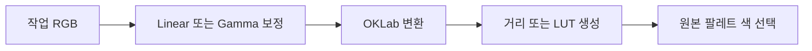
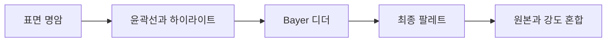
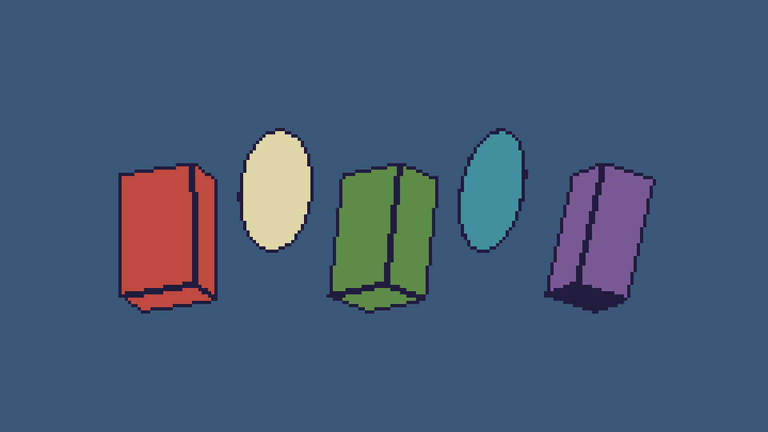
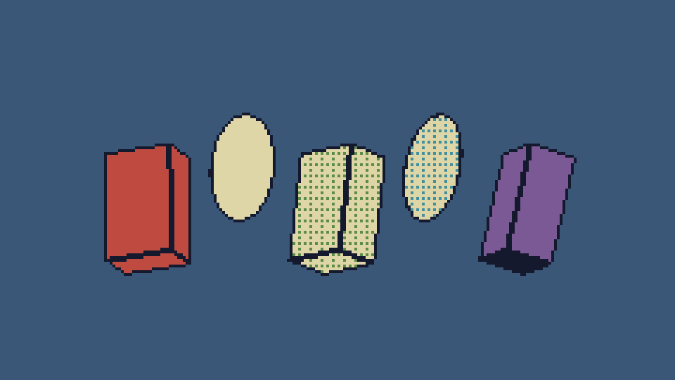
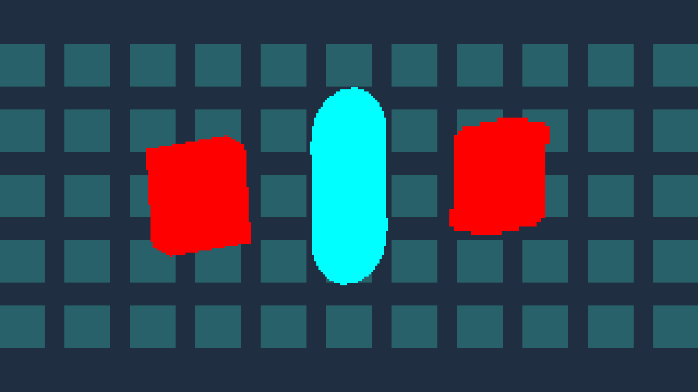

## 작업 결과

Pixel Camera0.6.3-preview에 CPU·GPU·LUT의 OKLab 매칭을 추가하고 윤곽선·하이라이트 뒤에 최종 팔레트를 적용했습니다.

## 변경 내용

### 적용 내용

영상0:50 해상도,1:29 툰,1:56 외곽선,2:29 팔레트/디더,3:09 애니메이션을 대조했습니다. 세부 누락은 OKLab, 일부 윤곽선의 최종 팔레트,256단계의 팔레트 디더였습니다.3:41 얼굴 소실은 모델 크기·해상도 문제로 구분했습니다. [영상](https://www.youtube.com/watch?v=sOSH-Vc7aJY) · [OKLab 원저자](https://bottosson.github.io/posts/oklab/).

기존 enum0/1과 bool API를 보존하고 OKLab=2를 추가했습니다. LUT 내부 모드는3입니다. 팔레트 좌표는 CPU에서 미리 변환하며 강도0·부분 적용을 보존합니다.



```csharp
public static void ToOKLab(float r, float g, float b, bool linear, out float lightness, out float greenRed, out float blueYellow)
        {
            if (!linear)
            {
                r = ToLinear(r);
                g = ToLinear(g);
                b = ToLinear(b);
            }
            double l = CubeRoot(.4122214708 * r + .5363325363 * g + .0514459929 * b);
            double m = CubeRoot(.2119034982 * r + .6806995451 * g + .1073969566 * b);
            double s = CubeRoot(.0883024619 * r + .2817188376 * g + .6299787005 * b);
            lightness = (float)(.2104542553 * l + .7936177850 * m - .0040720468 * s);
            greenRed = (float)(1.9779984951 * l - 2.4285922050 * m + .4505937099 * s);
            blueYellow = (float)(.0259040371 * l + .7827717662 * m - .8086757660 * s);
        }
```

```hlsl
float3 PCMapPalette(float3 rgb)
{
    if(_PaletteCount<=0)return rgb;
    if(_PaletteMode>2.5){float3 address=(floor(saturate(rgb)*(_PaletteLutSize-1)+.5)+.5)/_PaletteLutSize;return tex3D(_PaletteLut,address).rgb;}
    float distance=1e20;float3 closest=rgb;float3 hsv=_PaletteMode>.5&&_PaletteMode<1.5?PCPaletteHSV(rgb):0;float3 lab=_PaletteMode>1.5?PCToOKLab(rgb):0;
    [loop]for(int p=0;p<_PaletteCount;p++)
    {
        float3 delta=rgb-_Palette[p].rgb;float candidate=dot(delta*delta,float3(.2126,.7152,.0722));
        if(_PaletteMode>1.5){float3 deltaLab=lab-_PaletteLab[p].rgb;candidate=dot(deltaLab,deltaLab);}
        else if(_PaletteMode>.5){float3 other=PCPaletteHSV(_Palette[p].rgb);float hue=abs(hsv.x-other.x);hue=min(hue,1-hue);candidate=hue*hue*4*hsv.y*other.y+(hsv.y-other.y)*(hsv.y-other.y)*.5+(hsv.z-other.z)*(hsv.z-other.z);}
        if(candidate<distance){distance=candidate;closest=_Palette[p].rgb;}
    }
    return closest;
}
```



```hlsl
float4 PCFinishPalette(float2 uv, float4 color)
{
    uint side=(uint)max(2,_DitherSize);
    uint2 cell=(uint2)fmod(floor(uv*_PixelSize.xy),side);
    uint index=cell.y*side+cell.x;
    float threshold=_DitherPattern[index/4][index%4]-.5;
    if (_PaletteCount > 0 && _PaletteStrength > 0)
    {
        float3 mapped=PCMapPalette(color.rgb+threshold*_Dither/max(2,_PaletteCount-1));
        color.rgb=lerp(color.rgb,mapped,_PaletteStrength);
    }
    return color;
}
```

[CPU 전체 원본](../assets/video-20261116/PaletteAlgorithms.cs.txt) · [셰이더 전체 원본](../assets/video-20261116/Process.cginc.txt)

## 검증

Unity6000.0.83f1에서 실제 임포트·컴파일·렌더했습니다. 아래 Gamma 기준 화면은 변경 전과 첫 구현입니다. 최종 최적화 소스는 다음 Linear 설치본 렌더로 확인했습니다.







설치본 URP17.0.4 RenderGraph/DX11/Linear:24프레임과 외곽선12프레임의 불안정 쌍0, 인스턴싱 경고0, 배경 변화0, 마스크 복원. [측정](../assets/video-20261116/urp.json). 단위·회귀 테스트를 새로 작성하지 않았습니다. [대화](../assets/video-20261116/conversation.json).

## 남은 사항

Native Inspector 선택, 새 LUT 저장·재열기 UI,9개 언어 전체 배치, HDRP·XR·다른 플랫폼은 미확인입니다. LUT는 연속 색의 근사입니다. 강도1의 처리 대상 불투명 표면에 팔레트 포함 계약을 적용하며 Overlay UI·비대상 배경은 제외합니다. 제품 전용 코드라 공통 Unity 샘플 환류는 보류했습니다.

## 작업 시간

- 제안 시간: 최초40~70분, 새 예제 추가 후55~85분.
- 실제로 완료된 시간: 2026-11-16 13:00:04 KST 시작. 구현·실행·새 설치·초안 저장까지46분37초,13:46:41 KST 완료. 공개 보고·푸시는 별도입니다.
- XERJ: 미사용 — 사용자 지시에 따라 rg와 실제 자막·소스·Unity 로그·렌더·Publisher 재읽기를 사용했습니다.
