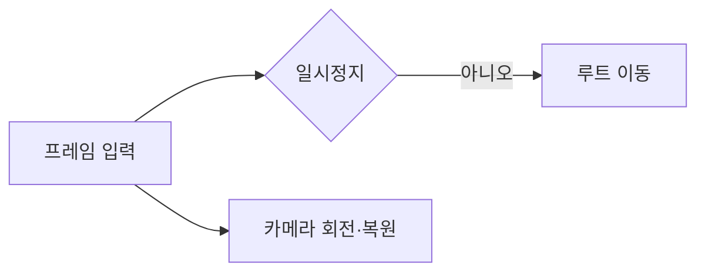
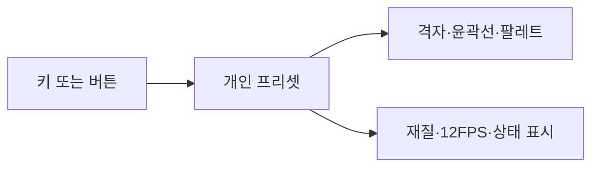
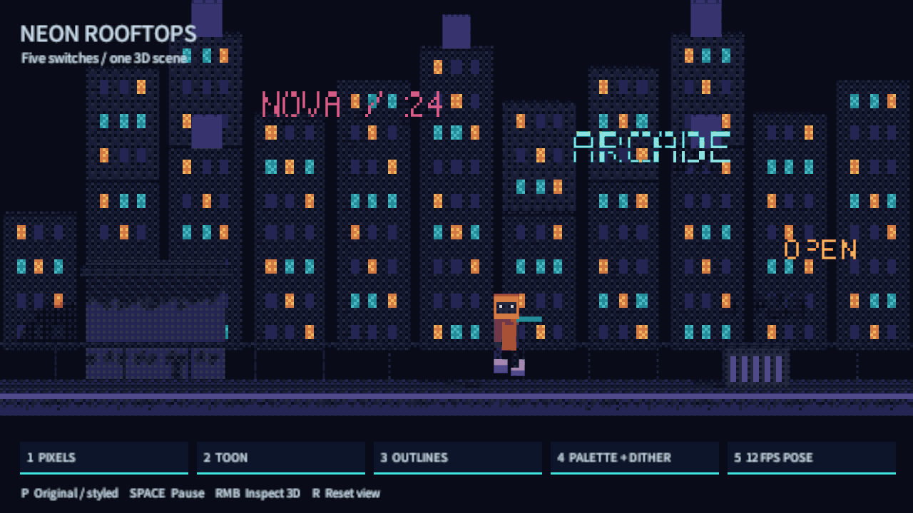
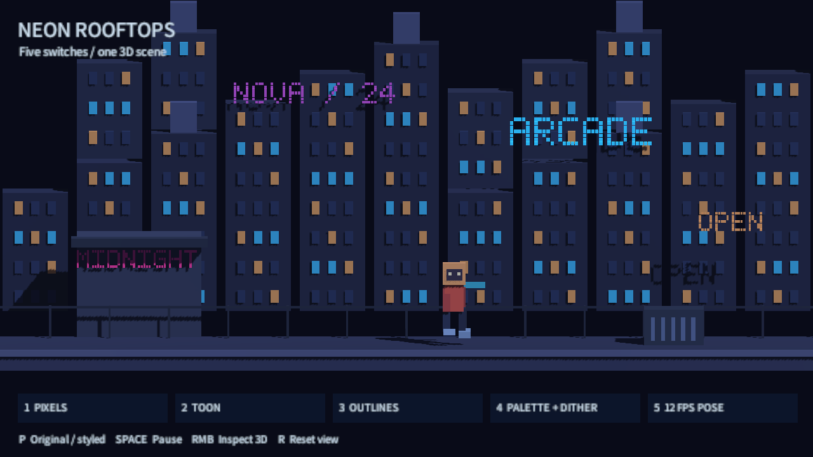
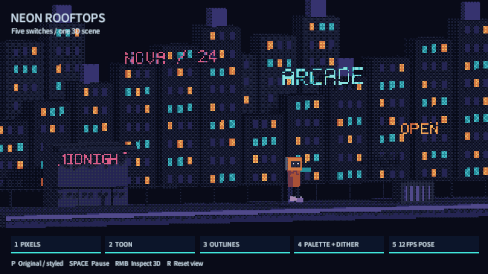
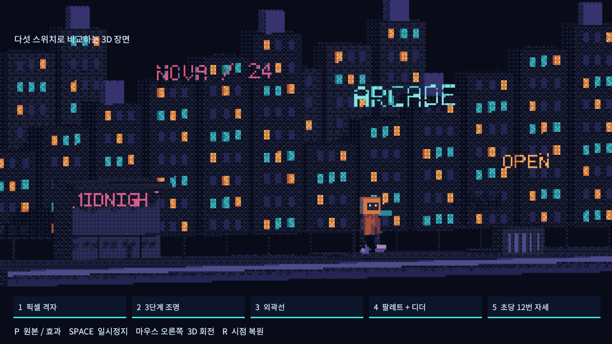

## 작업 결과

05-NeonRooftops.unity를 기존 Samples에 추가했습니다. 건물·네온 타일·러너·재질·Animator 클립·UI는 모두 편집 가능한 원본입니다.

## 변경 내용

### 적용 내용

1~5는 격자·3단계 조명·외곽선·32색 OKLab/Bayer4·12FPS 자세입니다. P 전체 비교, Space 일시정지, 오른쪽 드래그3D 회전, R 시점 복원입니다. UI 생성·폰트 덮어쓰기는 없습니다.





```csharp
using UnityEngine;

namespace TurnRoom.PixelCamera.Samples
{
    /// <summary>
    /// 저장된 네온 옥상 예제에서 다섯 렌더 효과와 연속 이동을 비교한다.
    /// </summary>
    public sealed class FiveSwitchShowcase : MonoBehaviour
    {
        public PixelCameraEffect effect;
        public PixelCameraPreset preset;
        public PixelCameraPalette palette;
        public Renderer[] surfaces;
        public Material[] smoothMaterials;
        public Material[] toonMaterials;
        public Transform runner;
        public PixelCameraSteppedAnimator steppedAnimator;
        public bool[] switches = { true, true, true, true, true };
        public GameObject[] enabledIndicators;
        public PixelCameraObject[] pixelObjects;
        public GameObject[] languageGuides;
        private PixelCameraPreset _working;
        private Vector3 _runnerHome;
        private Vector3 _cameraHome;
        private Quaternion _cameraRotation;
        private float _time;
        private bool _paused;

        private void Awake()
        {
            _runnerHome = runner.localPosition;
            _cameraHome = effect.transform.position;
            _cameraRotation = effect.transform.rotation;
            _working = Instantiate(preset);
            effect.preset = _working;
            ApplySwitches();
        }

        private void Update()
        {
            for (int i = 0; i < 5; i++)
            {
                if (Input.GetKeyDown((KeyCode)((int)KeyCode.Alpha1 + i)))
                {
                    ToggleSwitch(i);
                }
            }
            if (Input.GetKeyDown(KeyCode.P))
            {
                bool enabled = !switches[0];
                for (int i = 0; i < 5; i++)
                {
                    switches[i] = enabled;
                }
                ApplySwitches();
            }
            if (Input.GetKeyDown(KeyCode.Space))
            {
                _paused = !_paused;
                steppedAnimator.GetComponent<Animator>().speed = _paused ? 0 : 1;
            }
            if (!_paused)
            {
                _time += Time.deltaTime;
                runner.localPosition = _runnerHome + Vector3.right * Mathf.Sin(_time * .35f) * 3;
            }
            if (Input.GetMouseButton(1))
            {
                effect.transform.RotateAround(new Vector3(0, 3, 3), Vector3.up, Input.GetAxis("Mouse X") * 2);
            }
            if (Input.GetKeyDown(KeyCode.R))
            {
                effect.transform.SetPositionAndRotation(_cameraHome, _cameraRotation);
            }
        }

        private void OnDestroy()
        {
            if (_working != null)
            {
                Destroy(_working);
            }
        }

        /// <summary>
        /// 키보드와 저장된 버튼 이벤트에서 지정한 비교 기능을 전환한다.
        /// </summary>
        public void ToggleSwitch(int index)
        {
            if (index < 0 || index >= switches.Length)
            {
                return;
            }
            switches[index] = !switches[index];
            ApplySwitches();
        }

        /// <summary>
        /// 장면 자산을 보존하며 개인 프리셋과 렌더러의 비교 상태를 적용한다.
        /// </summary>
        public void ApplySwitches()
        {
            PixelCameraPreset settings = _working != null ? _working : preset;
            effect.enabled = switches[0] || switches[2] || switches[3];
            for (int i = 0; i < pixelObjects.Length; i++)
            {
                pixelObjects[i].pixelSize = switches[0] ? 4 : 1;
            }
            settings.outline = switches[2];
            settings.palette = switches[3] ? palette : null;
            settings.orderedDithering = switches[3];
            steppedAnimator.enabled = switches[4];
            for (int i = 0; i < surfaces.Length; i++)
            {
                surfaces[i].sharedMaterial = switches[1] ? toonMaterials[i] : smoothMaterials[i];
            }
            for (int i = 0; i < enabledIndicators.Length; i++)
            {
                enabledIndicators[i].SetActive(switches[i % 5]);
            }
        }
    }
}

```

## 검증

저장 씬을 다시 열어 Built-in/DX11/Linear로 실제 Play했습니다.1.6916초 동안14,233회 루트 이동 관찰과20회 자세 변화. 에디터 콜백 수이며 GPU FPS 수치가 아닙니다. 원본 프리셋 보존 확인. [실행](../assets/video-20261116/play.json).









새 장면이라 변경 전은 없습니다. Garden 재배치 없이 영상과 비슷한 야간 도심·보행로·러너를 독립 기하·재질로 작성했습니다. Overlay UI는 Unity 카메라로 효과 밖에 렌더했습니다. [대화](../assets/video-20261116/conversation.json).

## 남은 사항

새 예제의 URP 변환, 실제 키보드·마우스 조작, 공유 언어 변경의 네이티브 왕복과 나머지7개 언어 배치는 미확인입니다. 플레이어는 영어 기본이며 편집기에서는 저장된9개 안내 그룹을 공유 언어에 연결했습니다. 눈은 크게 모델링했으며 셀 미만 디테일 자동 복원은 아닙니다.

## 작업 시간

- 제안 시간: 최초40~70분, 새 예제 추가 후55~85분.
- 실제로 완료된 시간: 2026-11-16 13:00:04 KST 시작. 구현·실행·새 설치·초안 저장까지46분37초,13:46:41 KST 완료. 공개 보고·푸시는 별도입니다.
- XERJ: 미사용 — 사용자 지시에 따라 rg와 실제 자막·소스·Unity 로그·렌더·Publisher 재읽기를 사용했습니다.
