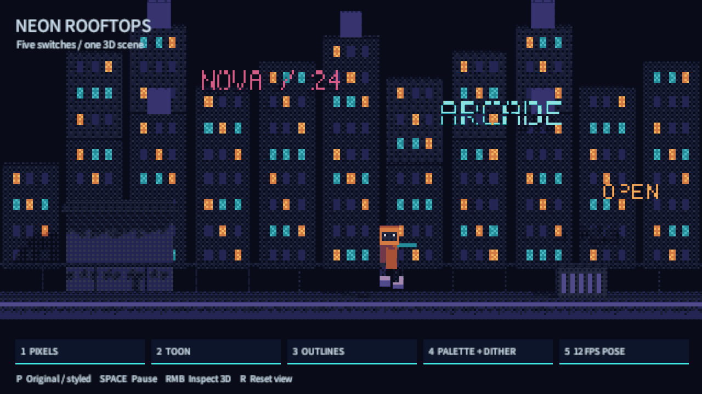

## 작업 결과

자막 대조·누락 기능·새 예제·9개 언어 문서·실제 실행·새 설치·공식 검사·초안 재등록을 완료했습니다. Pixel Camera는 현재 Pixora Studio 통합 초안에 포함됩니다.

## 변경 내용

### 적용 내용

[OKLab·팔레트 보완](2026-11-16-result-20261116045611311-v1.0.0.html) · [새 예제와 핵심 코드](2026-11-16-result-20261116045612680-v1.0.0.html)

| 항목 | 실제 결과 |
|---|---|
| 모듈 / 판매 버전 | Pixel Camera0.6.3-preview / Pixora Studio1.0.1 |
| 초안 |1547466 / draft|
| 파일 / 크기 |3,951개 /85,389,598바이트|
| SHA-256 |50f075aa2c506285d5877faaab2f9a6c3e41e4c0e2bc709aaa63a7751ef021bc|
| 저장 확인 |2026-11-16T13:46:41.7045659+09:00|
| 심사 제출 |미실행|

이전1.0.0은 pendingReview이며 변경하지 않았습니다. management 목록과 루트 GUID를 대조했습니다. 로컬96c59a0a1·04575630e·66d148a0b로 저장했고 다른 DDT·공유 창·README 변경을 보존했습니다. main 푸시·소개 사이트 배포는 자동 승인 검토 거부로 승인 대기입니다.

## 검증

- 공식 Asset Store Tools11.3.1:27 Pass·2 Warning·0 Fail. 경고는 기존 압축 파일과 JPG 문서 이미지입니다. [공식 결과](../assets/video-20261116/official.json).

- 새 빈 프로젝트에 고정 파일을 ImportPackage로 설치. 누락 스크립트0, 본체·샘플 어셈블리와0.6.3-preview 확인. [설치](../assets/video-20261116/install.json).

- asset/meta 재읽기: 소스 차이0, 개발 파일 유출0, 새 씬·컴포넌트 누락0. 무관한 공유 창 수정만 committed HEAD로 제외. [대조](../assets/video-20261116/package.json).

- SDK 세션 갱신으로401 복구 후 공식 업로드 API 사용. HTTP200/ok, 저장 크기85,389,598·draft 재조회. [영수증](../assets/video-20261116/upload.json).

- URP 설치본24+12프레임: 불안정 쌍0·배경 변화0·인스턴싱 경고0. 새 옥상 예제는 Built-in 범위입니다. [렌더](../assets/video-20261116/urp.json).

- 기존1.0.1 소개 URL의9개 언어 글·실제 썸네일 준비. 로컬183HTML·4,937개 링크 통과.

- 인증정보·원본 세션 덤프·전체 영상 자막은 게시하지 않았습니다. [대화](../assets/video-20261116/conversation.json).

## 남은 사항

Turnlume main 푸시·turnlume.pages.dev 게시 승인은 대기 중입니다. 구현·설치·초안 등록과 구분합니다. 네이티브 저작 UI·키보드·전체 언어 배치는 미확인입니다. 기존 압축/JPG 경고가 남습니다. 전역 지침 변경 없음. 프로젝트 지침에 확인된 팔레트 순서·색 공간 교훈만 통합합니다.

## 작업 시간

- 제안 시간: 최초40~70분, 새 예제 추가 후55~85분.
- 실제로 완료된 시간: 2026-11-16 13:00:04 KST 시작. 구현·실행·새 설치·초안 저장까지46분37초,13:46:41 KST 완료. 공개 보고·푸시는 별도입니다.
- XERJ: 미사용 — 사용자 지시에 따라 rg와 실제 자막·소스·Unity 로그·렌더·Publisher 재읽기를 사용했습니다.
