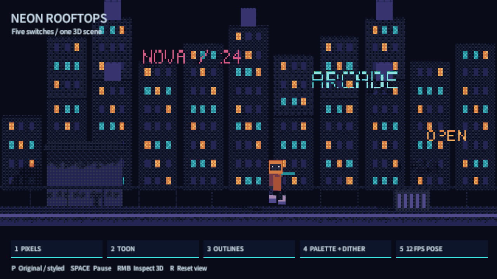

## 작업 결과

사용자의 “마저 다 해 ㅇㅇ” 승인 후 남아 있던 원격 푸시와 소개 글 배포를 완료했습니다. 기능·새 예제·초안 등록부터 공개 기록까지 요청한 작업을 마쳤습니다.

## 변경 내용

### 적용 내용

승인한96c59a0a1·04575630e·66d148a0b만 MDJ0126/Turnlume main에 푸시했습니다. 원격은66d148a0b28959d951ffed97826bc7899445d35e와 일치합니다. 기존 DDT 창2개·공유 창·루트 README의 미커밋 수정은 보존했습니다.

같은 버전 URL을 유지하며 영어·한국어·일본어·중국어 간체/번체·스페인어·프랑스어·독일어·브라질 포르투갈어 글과 실제 예제 썸네일을 게시했습니다.

[한국어 소개 글](https://turnlume.pages.dev/ko/updates/pixora-studio-1.0.1/) · [영문 소개 글](https://turnlume.pages.dev/updates/pixora-studio-1.0.1/) · [앞선 구현·설치·초안 보고](https://mdj0126.github.io/codex-config/projects/pixelcamera/reports/2026-11-16-result-20261116045614080-v1.0.0.html)

이전 보고의 승인 대기·자동 검토 거부 이력은 보존합니다. 이번 사용자 승인으로 남은 작업을 실행했습니다.

## 검증

- Git 원격 main 해시 대조 완료.
- GitHub Actions43812016004의 빌드·정적 검사·Cloudflare Pages 배포·공개 언어 경로 검사가 모두 성공했습니다. [실행](https://github.com/MDJ0126/Turnlume/actions/runs/43812016004) · [저장 근거](../assets/publication-20261116/publication-actions.json).
-9개 언어 버전 글을 HTTPS로 인증 없이 다시 읽어 로컬 빌드와 바이트 단위 일치를 확인했습니다. [재읽기](../assets/publication-20261116/publication-readback.json).
- 썸네일 공개 파일과 실제 Unity 캡처 바이트·SHA256이 같습니다. [이미지 근거](../assets/publication-20261116/thumbnail.json).
- Windows 로컬 전체 비교에서 기존 DDT 문서2개가 달랐으나 CRLF/LF 정규화 후 완전 일치했습니다. 배포 워크플로의 Linux 빌드 전체 경로 검사는 성공했습니다. 문서 내용 차이나 배포 실패로 보고하지 않았습니다.
- 새 코드나 패키지를 재생성하지 않았습니다. 이전에 검증·저장한85,389,598바이트의 초안1547466은 유지되며 심사 제출은 실행하지 않았습니다.

## 남은 사항

이번 요청의 필수 잔여 작업은 없습니다. 기존 공식 검사2개 경고와 Native 저작 UI·키보드·전체 언어 배치의 미확인 범위는 앞선 보고대로 보존합니다. 제품 전체의 심사 승인이나 미확인 플랫폼 지원을 의미하지 않습니다. 교훈은 기존 배포 후 재읽기·OS 줄바꿈 구분 원칙으로 충분하여 전역·프로젝트 지침 추가 변경 없음.

## 작업 시간

- 제안 시간: 5~10분
- 실제로 완료된 시간: 재개2026-11-16 14:42:04 KST. 푸시·소개 사이트 배포·공개 재읽기까지4분15초, 2026-11-16 14:46:19.144 KST. 보고서 추가 배포·정리는 별도 확인합니다.
- XERJ: 미사용 — rg·Git 원격·기존 자동 배포·공개 HTTP와 실제 파일 해시를 확인했습니다.
