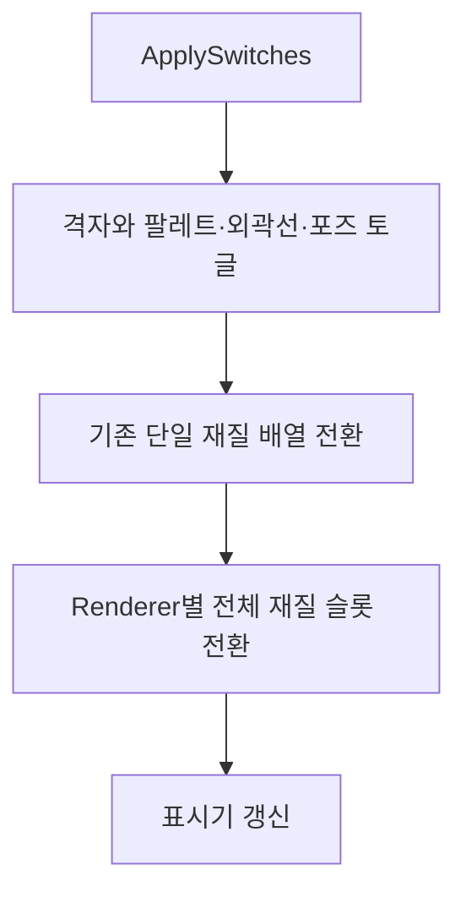
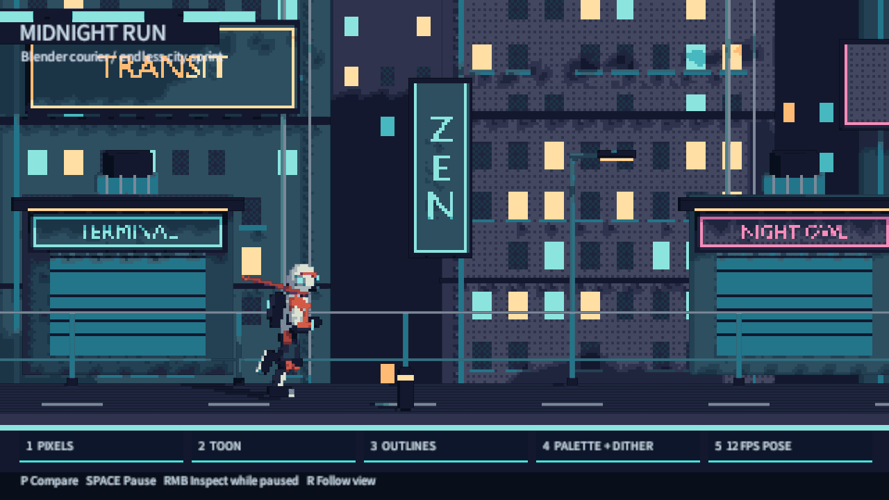
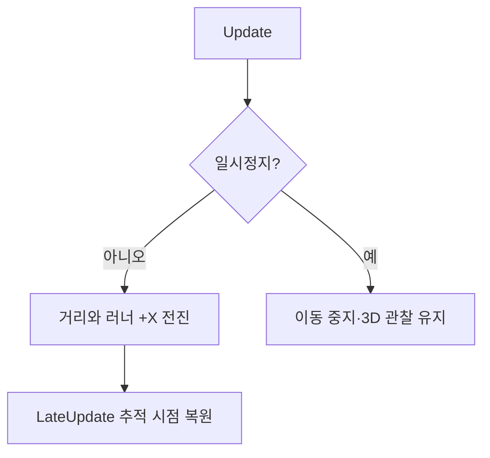
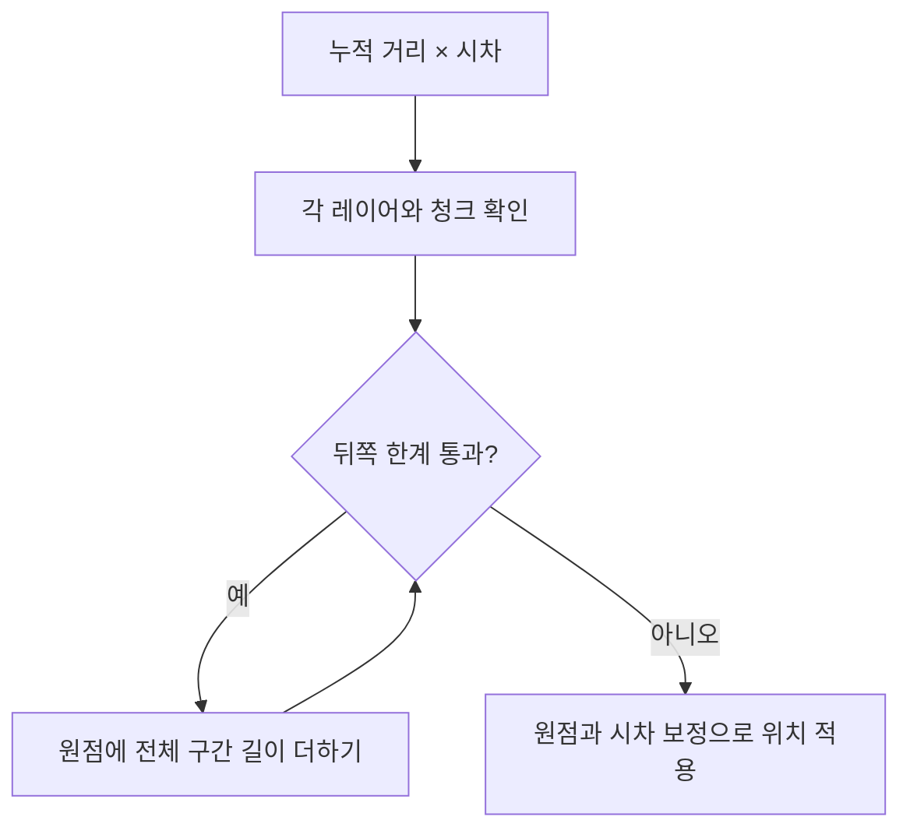
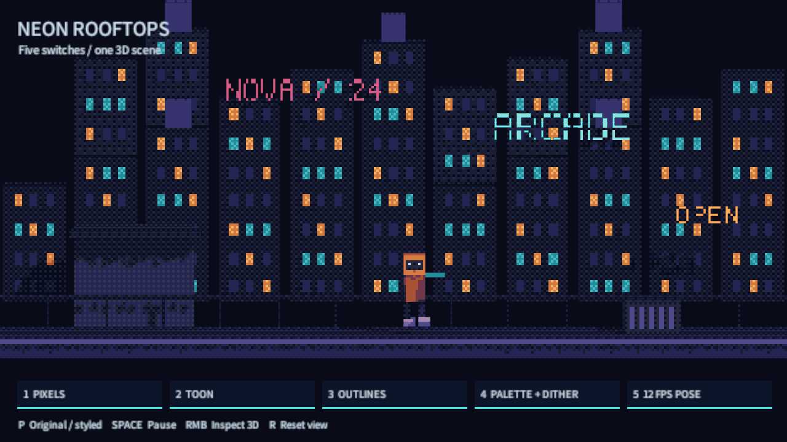
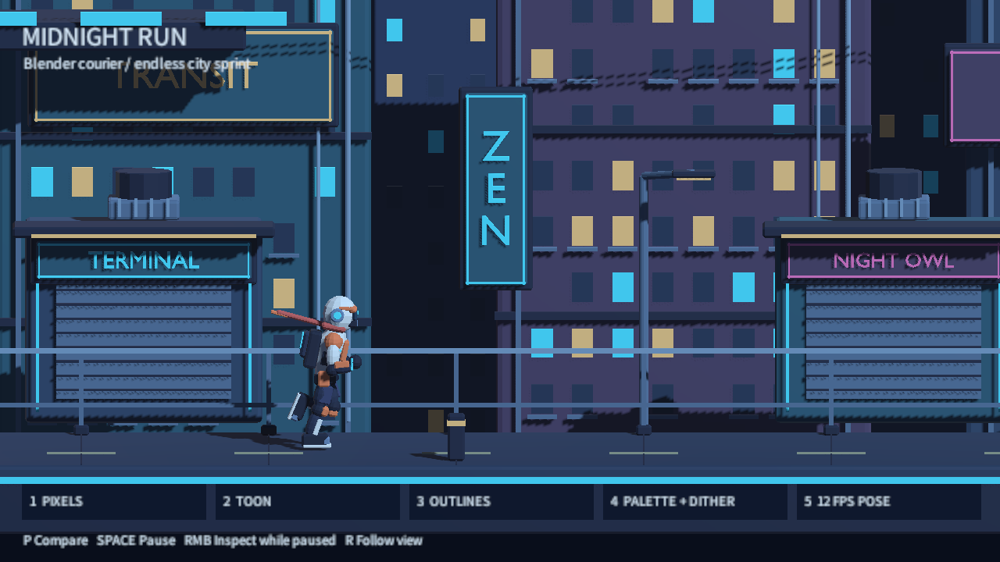

## 작업 결과

실제 Blender 원본2개와 FBX4개를 저장·재열기했습니다. 18본 가중치 러너가7.5m/s로 전진하며3개 도시 레이어를 순환합니다. 실제 Unity25.1초 플레이에서188.4m 이동·302회 자세 변화를 확인했습니다. [실행 영상—12초, 무음 실행 증거](../assets/midnight-run-20261116/MidnightRun-Play.mp4)

편집 가능한 원본2개와 재생성 스크립트는 프로젝트 ArtSources/Pixora/Blender/NeonSprint에 보관했습니다. 공개 첨부는 실제 실행 화면·로그로 제한합니다.

### 다중 재질 전환의 전체 메서드

```csharp
        public void ApplySwitches()
        {
            PixelCameraPreset settings = _working != null ? _working : preset;
            effect.enabled = switches[0] || switches[2] || switches[3];
            for (int i = 0; i < pixelObjects.Length; i++)
            {
                pixelObjects[i].pixelSize = switches[0] ? 4 : 1;
            }
            settings.outline = switches[2];
            settings.palette = switches[3] ? palette : null;
            settings.orderedDithering = switches[3];
            steppedAnimator.enabled = switches[4];
            for (int i = 0; i < surfaces.Length; i++)
            {
                surfaces[i].sharedMaterial = switches[1] ? toonMaterials[i] : smoothMaterials[i];
            }
            if (materialSets != null)
            {
                foreach (var set in materialSets)
                {
                    if (set.renderer != null)
                    {
                        set.renderer.sharedMaterials = switches[1] ? set.toon : set.smooth;
                    }
                }
            }
            for (int i = 0; i < enabledIndicators.Length; i++)
            {
                enabledIndicators[i].SetActive(switches[i % 5]);
            }
        }
```



## 변경 내용

### 적용 내용



기존 장면 경로·GUID와 예제 메뉴를 유지했습니다. 기존 세 예제는 보존하고 폐기한 네온 큐브 재질은 제거했습니다. 아래는 질주·카메라·시차 순환을 담당하는 전체 컴포넌트입니다.

```csharp
using UnityEngine;

namespace TurnRoom.PixelCamera.Samples
{
    /// <summary>
    /// 연속 질주와 추적 카메라·깊이별 도시 순환을 담당한다.
    /// </summary>
    public sealed class NeonSprintLoop : MonoBehaviour
    {
        [System.Serializable]
        public struct CityLayer
        {
            public Transform[] chunks;
            [Range(.05f, 1.2f)] public float parallax;
            public float length;
        }

        public FiveSwitchShowcase showcase;
        public Transform runner;
        public Camera followCamera;
        public float speed = 7.5f;
        public float lead = 2.8f;
        public CityLayer[] layers;
        private Vector3 _cameraHome;
        private Quaternion _cameraRotation;
        private float[][] _origins;
        private float _distance;

        public float Distance => _distance;

        private void Awake()
        {
            _cameraHome = followCamera.transform.position;
            _cameraRotation = followCamera.transform.rotation;
            _origins = new float[layers.Length][];
            for (int i = 0; i < layers.Length; i++)
            {
                _origins[i] = new float[layers[i].chunks.Length];
                for (int j = 0; j < layers[i].chunks.Length; j++)
                {
                    _origins[i][j] = layers[i].chunks[j].position.x;
                }
            }
        }

        private void Update()
        {
            if (Input.GetKeyDown(KeyCode.R))
            {
                ResetView();
            }
            if (showcase.IsPaused)
            {
                return;
            }
            float delta = Mathf.Max(0, Time.deltaTime);
            _distance += speed * delta;
            runner.position += Vector3.right * speed * delta;
            UpdateLayers();
        }

        private void LateUpdate()
        {
            if (showcase.IsPaused)
            {
                return;
            }
            ResetView();
        }

        /// <summary>
        /// 실제 캐릭터 이동과 독립된 거리로 각 깊이의 모듈을 화면 밖에서 재배치한다.
        /// </summary>
        private void UpdateLayers()
        {
            for (int i = 0; i < layers.Length; i++)
            {
                CityLayer layer = layers[i];
                if (layer.chunks == null || layer.chunks.Length < 2 || layer.length <= 0)
                {
                    continue;
                }
                float travel = _distance * layer.parallax;
                float span = layer.length * layer.chunks.Length;
                for (int j = 0; j < layer.chunks.Length; j++)
                {
                    while (travel - _origins[i][j] > layer.length * .5f + 22)
                    {
                        _origins[i][j] += span;
                    }
                    Vector3 position = layer.chunks[j].position;
                    position.x = _origins[i][j] + _distance * (1 - layer.parallax);
                    layer.chunks[j].position = position;
                }
            }
        }

        /// <summary>
        /// 전진 중인 캐릭터보다 앞을 보여 주는 횡스크롤 시점을 복원한다.
        /// </summary>
        public void ResetView()
        {
            followCamera.transform.SetPositionAndRotation(
                new Vector3(runner.position.x + lead, _cameraHome.y, _cameraHome.z),
                _cameraRotation);
        }
    }
}

```





## 검증

### 실제 전후 화면






- Blender5.2.3 LTS 최종 원본 재열기: 러너18본·가중 메시1·Action1, 도시27메시. 디스크 해시 보존. [근거](../assets/midnight-run-20261116/blender-final-reopen.json)
- 추가17초 실제 실행:91,098회 전진·역방향0회. 모든 레이어가 카메라 기준 뒤로 이동하고 중경·데크가 재순환했습니다. [상대 이동 기록](../assets/midnight-run-20261116/trajectory.json)
- Unity6000.0.83f1 / Built-in DX11 / Linear.25.1초·188.4m·302자세 변화와6개 청크 재배치. [실행 값](../assets/midnight-run-20261116/play-motion.json)
-12초1280×720 /24FPS:288프레임 전체 인코드·디코드. 음향 없는 실행 증거이며 판매용 홍보 영상으로 판정하지 않았습니다. [근거](../assets/midnight-run-20261116/video-encoding.json)
- 공식 validator25 Pass·4 Warning·0 Fail, 컴파일 오류 없음. 경고: Compressed Files / Mesh Prefabs / Model Orientation / JPG. [전체 결과](../assets/midnight-run-20261116/release-validation.json)
- 패키지2,885파일·80,681,626바이트. SHA256 79db0667e010e18a4e188195b1fbdaaaf22c78c1be01ef6cfd25ea0c801658ea. Stage asset/meta 차이0. 사용자 수정 중인 공용 WindowMouseActivationGuard는 검증된HEAD본을 패키지에 사용하고 작업 파일을 보존했습니다. [대조](../assets/midnight-run-20261116/package-audit.json)
- 새 프로젝트 실제 ImportPackage: 누락 스크립트0·질주 제어기1·스킨 메시1·core→sample 의존 없음. 첫 확인은 비동기 가져오기보다 빨라 실패했으며 완료 이벤트·도메인 재로드 후 확인으로 수정하여 통과했습니다. [새 설치](../assets/midnight-run-20261116/fresh-import.json)
- 초안1547466 /1.0.1: 업로드 후80,681,626바이트·draft 재조회. 기존1541558 /1.0.0 pendingReview 유지. [서버 재조회](../assets/midnight-run-20261116/store-readback.json)
- main f648f790384f7f0d84b209b57be18c923f05ce95; 소개 사이트9언어 본문·같은 버전 URL·새 썸네일 공개 확인. [공개 재읽기](../assets/midnight-run-20261116/publication-readback.json)
-9언어 문서·실제 캡처·ScreenshotManifest 갱신. 문서 경로 검사 통과.
- 컴퓨터 유즈·마우스·키보드·포커스 조작 없음. Unity 성공 배치 모두 ownForegroundObserved=false. 격리 라이선스 연결 실패는 실제 환경의 배치 실행으로 해결했습니다.

## 남은 사항

Native 입력 조작, 모든9언어 화면 배치, 이 예제의URP·HDRP·XR·타 플랫폼은 미확인입니다. 공식4개 경고는 보존했으며 심사 승인·제출을 의미하지 않습니다. 최종 심사 제출은 하지 않았습니다. 기존 사용자 수정 파일과 다른 Unity 작업을 보존했습니다.

### 대화 기록

사용자는 기존 예제가 성의 없다고 지적하며 “블랜더로 모델 만들고 … 다 다시 만들어서 횡스크롤로 질주하는 씬”을 요구했습니다. 이어 “컴퓨터 유즈 안 쓰고 … 나 써야해”라고 제약했고, 왕복하지 않고 앞으로 계속 달리며 배경이 스크롤돼야 한다고 다시 명시했습니다. 원본 모델·리깅·도시를 재제작하고 배치/API 경로를 유지했습니다.

### 지침 환류

검증한 교훈을 PixoraAuthoring 및 Pixel Camera 프로젝트 지침에 통합했습니다: 단순 큐브 대체 금지, 실제 Blender 원본 보존, 한 방향 질주와 구간 순환을 실행 값으로 확인. 기존 전역 비간섭 원칙은 중복 추가하지 않았습니다.

## 작업 시간

- 제안 시간: 60~90분
- 실제로 완료된 시간: 시작2026-11-16 16:15:41 KST. 구현·배치 실행·새 설치·초안 업로드·main 푸시·소개 사이트 공개 확인까지 약71분, 2026-11-16 17:26:53 KST. 이 보고서 자체의 배포·공개 확인은 후속으로 수행합니다.
- XERJ: 미사용 — 사용자 지시에 따라 rg·직접 소스·실제 Blender와 Unity 배치 로그를 사용했습니다.
