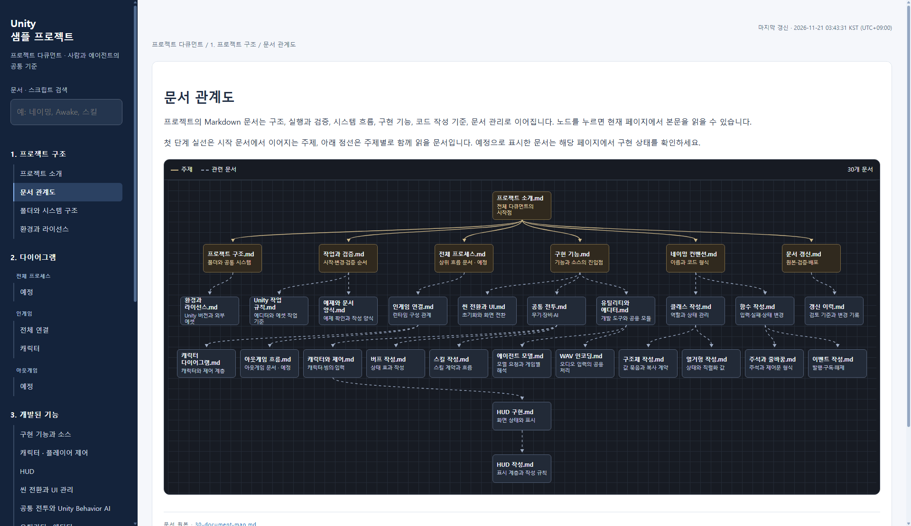

## 작업 결과

[샘플 다큐먼트 관계도](https://mdj0126.github.io/SampleProjectForUnity/docs/documentation/30-document-map.html)와 [README 안내](https://github.com/MDJ0126/SampleProjectForUnity#1-프로젝트-문서)를 추가했습니다.

## 변경 내용

### 적용 내용

- 프로젝트 소개에서 구조, 작업·검증, 흐름도, 구현 기능, 컨벤션, 문서 갱신으로 이어지는 관계를 한글 Markdown 목록으로 관리합니다. 첫 단계는 실선, 관련 문서는 점선으로 표시합니다.
- 기존 다큐먼트에서 각 노드를 누르면 본문과 코드 예제가 팝업으로 열립니다. 전체 문서 열기와 뒤로 이동은 기존 다큐먼트 탐색에 연결했습니다.
- README와 문서 소개에 진입 링크를 추가했고, 새 문서가 관계도에서 빠지거나 같은 문서를 중복 연결하면 빌드에서 확인합니다.
- 사용자 요청은 포트폴리오에서 사용하는 샘플 프로젝트의 문서 관계도와 README 설명을 추가하는 것이었습니다. 새로운 전역 지침을 추가할 근거는 없었습니다.

## 검증

- 문서 31개를 빌드했습니다. 독립 페이지 검사, 기존 탐색·소스 검색, 갱신 스냅샷 검증과 Pages 패키지의 링크 1,166개 검사를 통과했습니다.
- 실제 Chrome에서 Pages 경로의 소개에서 관계도로 이동해 노드 30개와 연결 29개를 확인했습니다. 본문·Mermaid 팝업, Esc, 본문 이동과 뒤로 가기를 확인했습니다.
- 샘플 저장소 커밋 `248fdba`를 원격 main에 푸시했습니다.

## 남은 사항

작성 시점에 샘플 Pages 배포가 대기 중입니다. 포트폴리오 소스의 샘플 저장소 링크를 확인했으나 공개 홈은 조회 시 HTTP 404였습니다. Unity 실행은 확인하지 않았습니다.

## 작업 시간

- 제안 시간: 8~10분
- 실제로 완료된 시간: 구현·실행 검증 및 샘플 저장소 푸시 8분 4초, 2026-11-21 03:45:19 KST
- XERJ: 미사용 — 샘플 프로젝트 및 포트폴리오 소스, Chrome과 공개 HTTP 응답을 확인했습니다.
