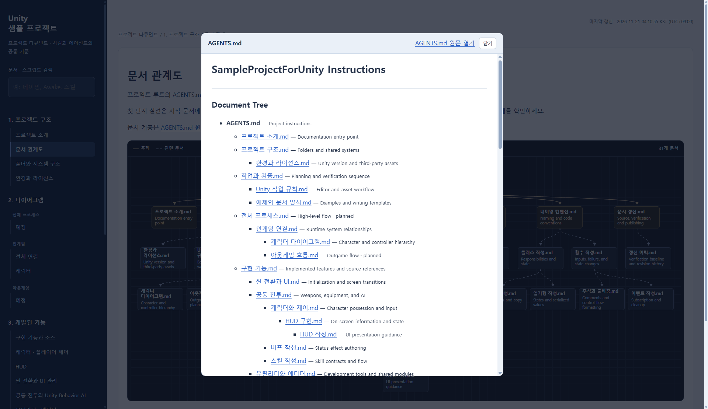

## 작업 결과

[샘플 프로젝트 관계도](https://mdj0126.github.io/SampleProjectForUnity/docs/documentation/30-document-map.html)에서 AGENTS.md 문서 트리를 열고 바깥 클릭으로 닫을 수 있습니다.

## 변경 내용

### 적용 내용

AGENTS.md의 Document Tree를 문서 계층의 기준으로 삼았습니다. 웹 관계도와 팝업에 같은 계층을 표시합니다. 모달 바깥 클릭은 닫고 내부 클릭은 본문을 읽을 수 있게 유지합니다. 샘플 프로젝트 main에 푸시했습니다. 커밋은 9d6a681입니다.

## 검증

로컬 빌드 및 실제 Chrome에서 31개 문서 구조, 내부 클릭 후 열린 상태, 바깥 클릭 후 모달 닫기와 노드 초점 복귀를 확인했습니다. 서로 다른 GIF 프레임 2개를 확인했습니다.

## 남은 사항

보고서 작성 시점의 새 Pages 배포는 미확인입니다.

## 작업 시간

- 제안 시간: 7~10분
- 실제로 완료된 시간: 4분 39초, 04:11:40 KST 기준
- XERJ: 미사용 — 실제 Markdown과 빌드 출력 및 Chrome 클릭 동작을 대조했습니다.
