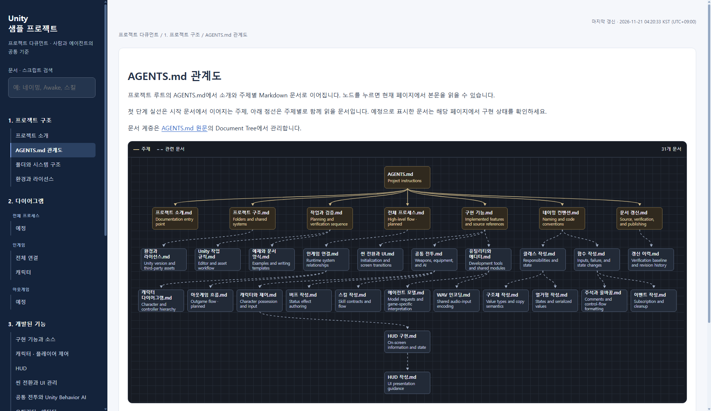

## 작업 결과

페이지와 진입 링크에서 AGENTS.md 관계도 이름을 확인할 수 있습니다.

## 변경 내용

### 적용 내용

사용자는 전역 및 샘플 프로젝트의 기존 관계도 이름을 AGENTS.md를 중심으로 통일해 달라고 요청했습니다.

## 검증

다큐먼트 목차와 본문·탭 제목, 소개와 README 링크를 AGENTS.md 관계도로 표시합니다. Chrome에서 제목·목차와 문서 진입을 확인했고, 00b38af를 main에 푸시했습니다.

## 남은 사항

보고서 작성 시점에는 해당 이름의 공개 배포를 확인 중입니다.

## 작업 시간

- 제안 시간: 구현·검증 3~5분
- 실제로 완료된 시간: 1분 43초 경과, 04:21:17 KST 기준
- XERJ: 미사용 — 로컬 문서와 실제 브라우저 화면을 대조했습니다.
