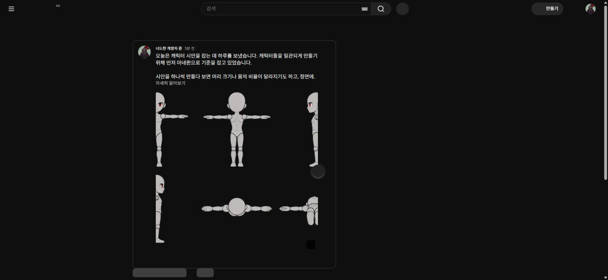
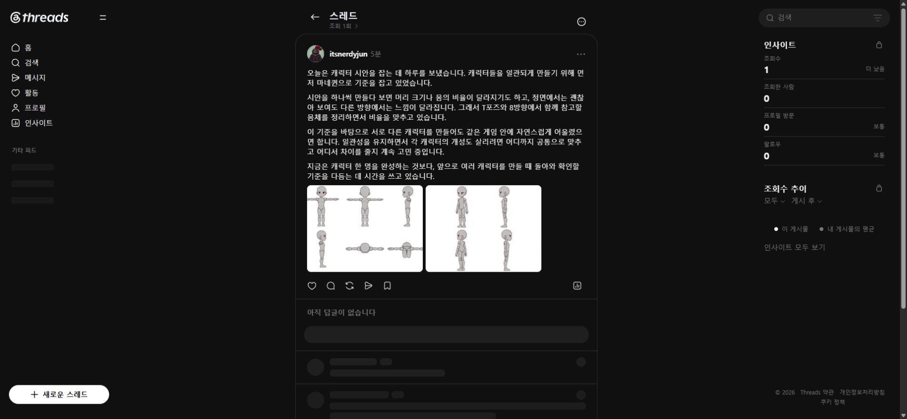
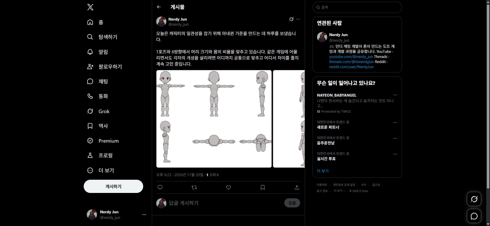

## 작업 결과

세 계정의 실제 게시 본문·이미지 2장·고유 URL 확인.

[YouTube](https://www.youtube.com/post/Ugkx20Jj0MkevLeG-_fxHWf2brqCDWUx98Y1) · [Threads](https://www.threads.com/@itsnerdyjun/post/Df9UuW4mi5h) · [X](https://x.com/nerdy_jun/status/2123708602167005294)

## 변경 내용

### 적용 내용

YouTube·Threads는 4문단 378자, X는 제한에 맞춰 축약했습니다. T포즈·8방향 마네퀸 PNG 2장을 같은 순서로 직접 첨부했습니다. 반복적인 공유 인사를 제외했습니다.

## 검증

Chrome 확장 DOM 직접 제어로 세 게시물 계정·본문·실제 첨부·URL 확인. 게시 화면 JPG 3개 저장. 제출 호출 응답이 300초 시간 초과되어 재제출하지 않고 실제 게시 결과를 읽어 중복을 방지했습니다.

## 남은 사항

원격 업데이트 fetch failed로 최신 미확인. 알려진 2026-11-20-014와 사용자 최신 지침 적용. 다른 로컬 변경으로 start 중단되어 해당 작업만 별도 동기화. SkillEvaluator는 신규 스킬 추가가 없어 비대상. CLI-Anything은 기존 Chrome DOM API로 작업 충족. 중앙 배포 확인은 대기하지 않습니다.

## 작업 시간

- 제안 시간: 5–8분
- 실제로 완료된 시간: 2026-11-20 18:21:14 KST 시작; 실제 게시 확인·캡처 18:28:42 KST(7분28초). 이후 기록 저장·푸시.
- XERJ: 미사용 — 원본 이미지 보존; 내부 게임명 비노출. 세 실제 게시 화면만 기록.
