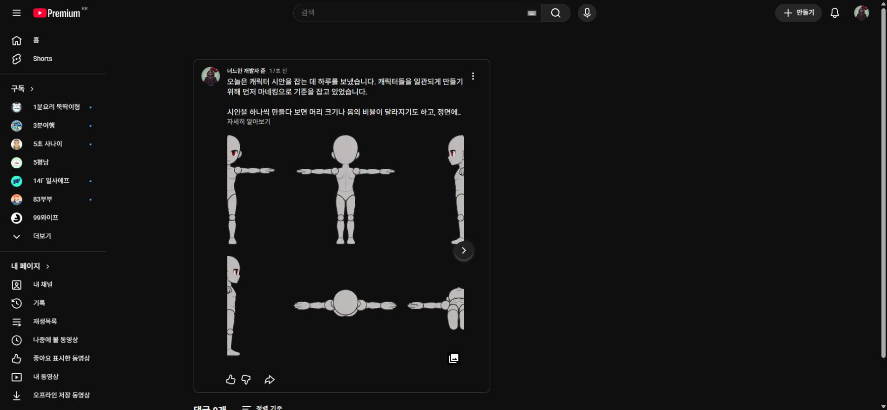
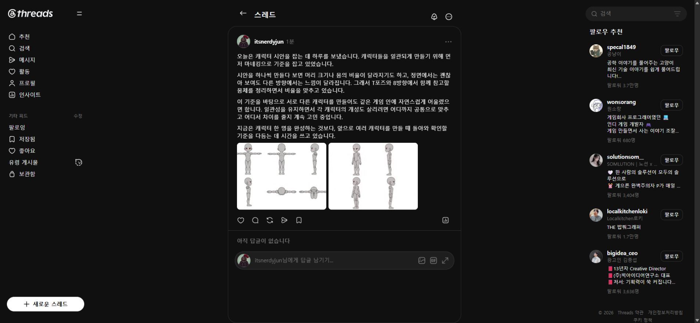
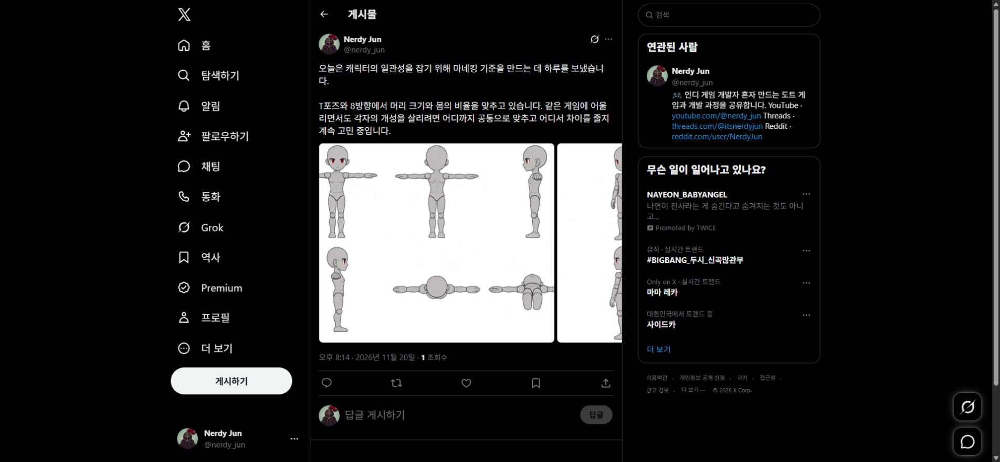

## 작업 결과

[YouTube 새 글](https://www.youtube.com/post/Ugkxv-NCwEGkeWeMSBiQVw0iIHxRAvGANJbh) · [Threads 새 글](https://www.threads.com/@itsnerdyjun/post/Df9hhl7mjB7) · [X 새 글](https://x.com/nerdy_jun/status/2123736751378452933)

## 변경 내용

### 적용 내용

기존 본문을 편집하지 않고 별도 새 글로 게시했습니다. 표기만 마네킹으로 교정하고 기존 이미지 2장과 설명을 유지했습니다. 한글 문체 기준에 표기를 통합했습니다. 과거 내부 기록은 보존했습니다.

## 검증

자동 승인 검토가 삭제 메뉴를 거절한 뒤, 사용자가 기존 세 글 삭제 후 새로 게시를 명시 확인했습니다. YouTube 기존 URL Ugkx20Jj0MkevLeG-_fxHWf2brqCDWUx98Y1 사용 불가, X 기존 2123708602167005294 삭제 토스트와 존재하지 않는 페이지 확인. Threads 기존 Df9UuW4mi5h 삭제 실행 후 홈 이동·기존 URL 접근 시 프로필 이동 확인. 새 고유 URL 세 곳에서 계정·마네킹 본문·실제 첨부 2장 확인. 게시 화면 JPG 3장 저장.

## 남은 사항

원격 업데이트 fetch failed로 최신 미확인; 알려진014와 사용자 지침 적용. 기존 로컬 변경은 보존. 중앙 아카이브는 배포 대기하지 않음. SkillEvaluator 신규 스킬 추가 없음; Chrome 직접 DOM API 재사용으로 CLI harness 제작 비대상.

## 작업 시간

- 제안 시간: 5–8분
- 실제로 완료된 시간: 2026-11-20 20:11:34 KST 시작; 실제 삭제·재게시·화면 확인 20:15:46 KST(4분12초). 이후 기록·푸시.
- XERJ: 미사용 — 기존 실제 게시물 3개와 새 게시물 3개만 조작; 원본·타 게시물 보존
