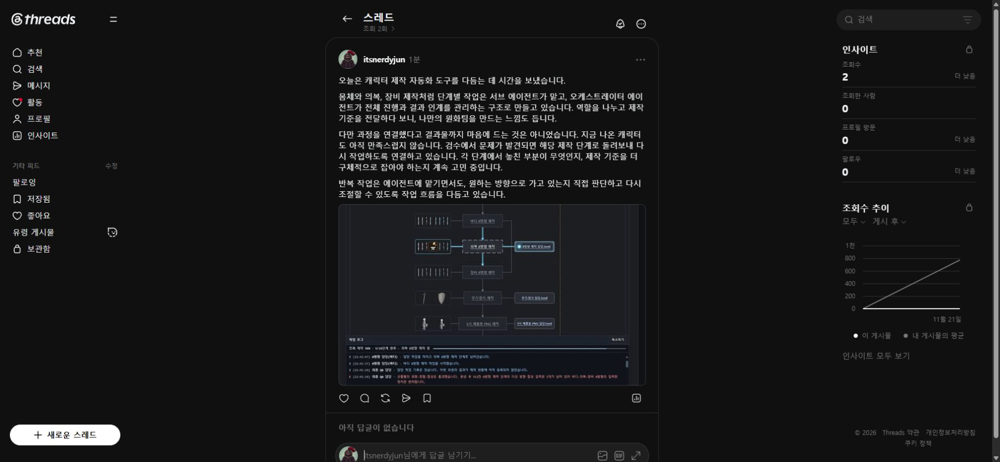
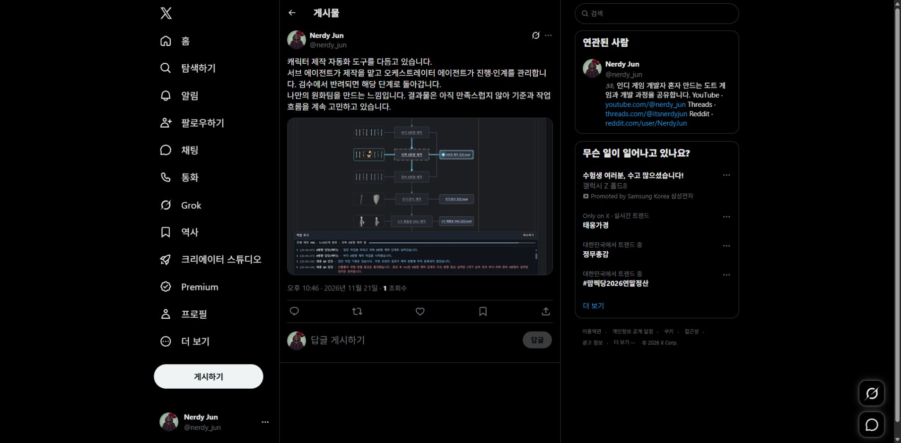
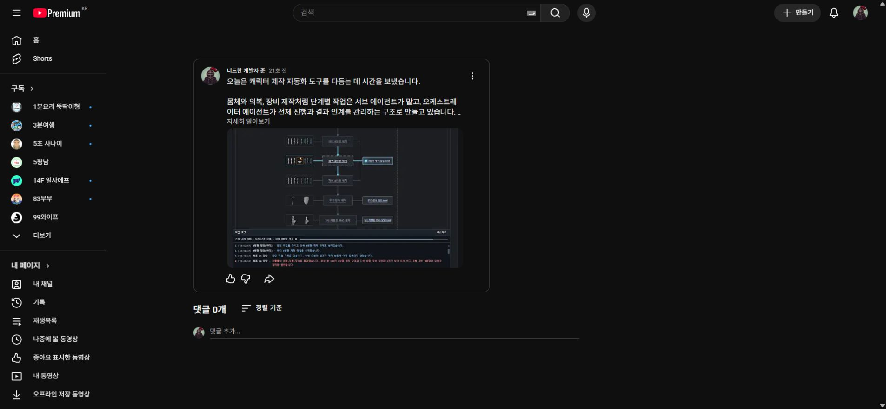

## 작업 결과

[YouTube](https://www.youtube.com/post/UgkxzkMG90RX75_XjtKCFkLlLcIflG70WVBT) · [Threads](https://www.threads.com/@itsnerdyjun/post/DgAXtFhmm3_) · [X](https://x.com/nerdy_jun/status/2124137368693424613) 실제 게시 확인.

## 변경 내용

### 적용 내용

YouTube·Threads에는 409자 본문, X에는 같은 내용을 글자 제한에 맞게 축약했습니다. 나만의 원화팀 표현과 결과물은 아직 만족스럽지 않다는 내용을 유지했습니다. 사용자 제공 반려 화면 PNG 한 장만 첨부하고 기존 글은 변경하지 않았습니다.

## 검증

Chrome 확장 DOM 직접 제어로 세 계정·실제 본문·실제 이미지 1장·고유 URL 확인. 실제 게시 화면 JPG 3개 저장 후 파일을 열어 내용 확인. 이미지에 내부 게임명 노출 없음. 신규 생성·PixelLab 실행 없음. 기존 로컬 변경은 보존하고 이번 기록만 별도 커밋합니다.

## 남은 사항

원격 업데이트 조회 fetch failed; 알려진014와 사용자 최신 지침 적용. 모바일 표시 미확인. 중앙 보고서 배포 확인은 대기하지 않습니다. SkillEvaluator 신규 스킬 없음, Chrome DOM API 재사용으로 CLI-Anything harness 제작 비대상.

## 작업 시간

- 제안 시간: 5–8분
- 실제로 완료된 시간: 2026-11-21 22:44:25 KST 시작; 게시·실제 화면 확인 22:47:28 KST(3분3초). 이후 기록·푸시 별도.
- XERJ: 미사용 — 원본 첨부 보존, 실제 게시 화면만 기록
