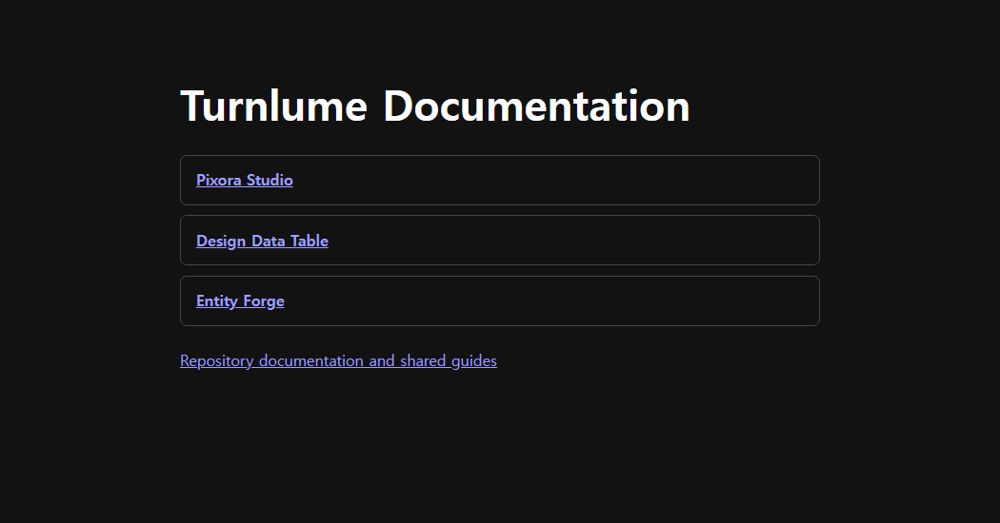

## 작업 결과

Pixora Studio, Design Data Table, Entity Forge의 가이드를 인덱스에서 각각 열 수 있습니다.

## 변경 내용

### 적용 내용

기존 루트 HTML 리디렉션을 세 제품의 현재 가이드 링크와 저장소 문서 목차 링크로 교체했습니다.

## 검증

Chrome 헤드리스에서 실제 file URL을 열어 자동 이동이 없음을 확인했습니다. 세 링크를 차례로 클릭해 대상 URL의 페이지 로드와 제목을 대조했고 최초 화면을 PNG로 저장했습니다.

## 남은 사항

모바일 표시와 중앙 아카이브 배포는 미확인입니다.

## 작업 시간

- 제안 시간: 3~7분
- 실제로 완료된 시간: 구현 및 브라우저 확인 2분 2초, 2026-11-20 18:17:33 KST
- XERJ: 미사용 — HTML과 빌드 출력 경로를 rg로 확인했습니다.
